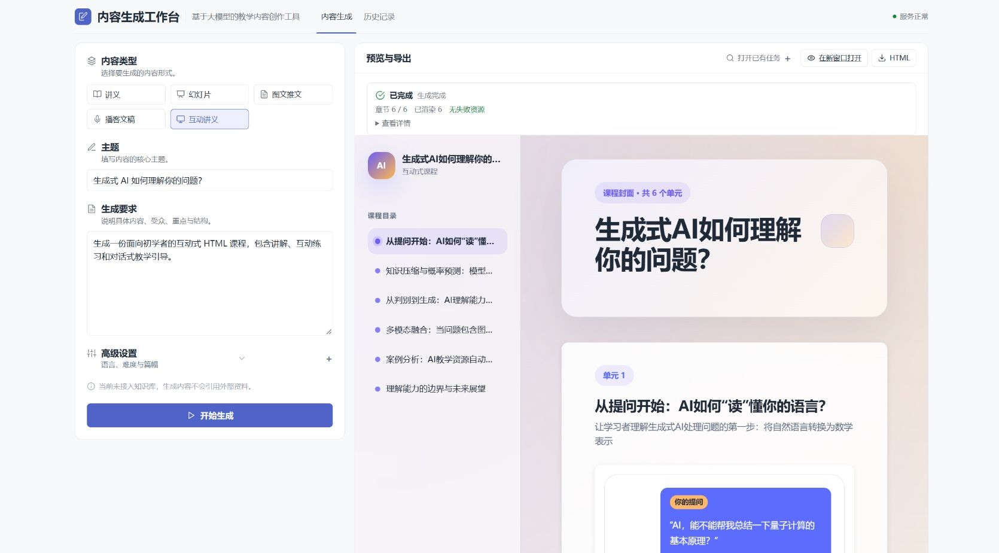
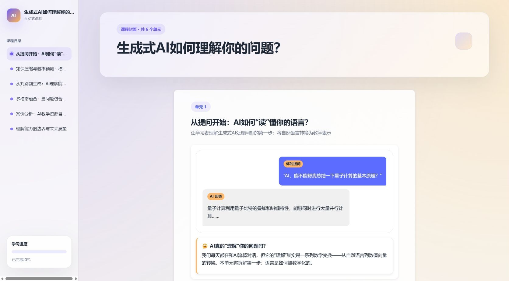
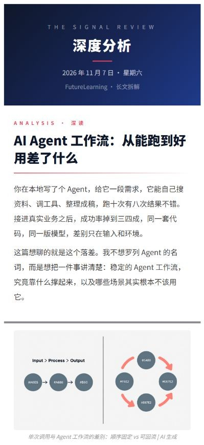
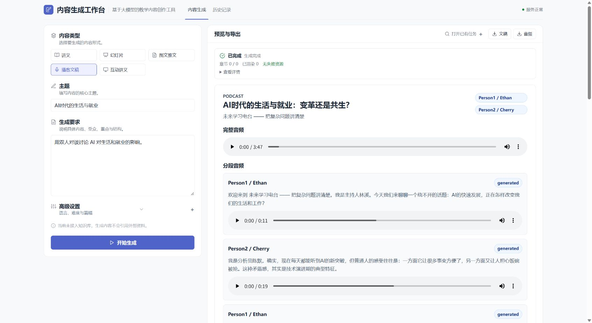
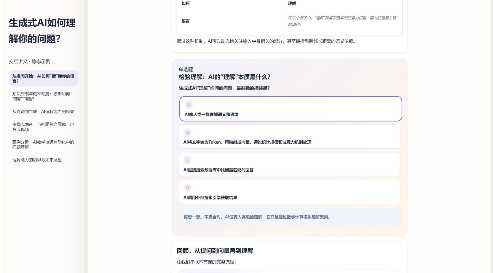

# LearnCraft

**AI 学习内容创作工具**

**把想学的主题，变成一份能读、能练、能复习的交互讲义。**

想弄懂一个新概念，或者找个主题从头学起？写下你的基础和学习要求，让 Agent 规划章节、组织讲解和练习。读一段，试着回答几个问题，再看看哪些地方值得回头复习。

LearnCraft 从一个学习主题出发，生成交互讲义、图文讲义、双人播客、图文推文与幻灯片。项目提供完整的网页工作台，也支持通过 HTTP API 接入自己的应用。

[工作台](#工作台) · [生成效果](#生成效果) · [交互讲义](#边读边练继续复习) · [快速开始](#快速开始) · [配置指南](docs/configuration.md) · [架构与开发](docs/architecture.md)

## 工作台

选择内容形式、写下要求，生成后就能在同一页面预览和导出。



## 生成效果

<table>
<tr>
<td width="50%" align="center"><strong>交互讲义</strong><br><a href="docs/assets/screenshots/interactive-home.jpg"></a><br>分章阅读，穿插互动练习。</td>
<td width="50%" align="center"><strong>图文讲义</strong><br><a href="docs/assets/screenshots/lecture-home.jpg"></a><br>把概念、案例和配图组织成完整讲义。</td>
</tr>
<tr>
<td align="center"><strong>图文推文</strong><br><a href="docs/assets/screenshots/social-mobile.jpg"></a><br>生成正文与配图，预览文章排版。</td>
<td align="center"><strong>播客</strong><br><a href="docs/assets/screenshots/podcast.jpg"></a><br>双人对谈脚本，配分段语音与完整音频。</td>
</tr>
</table>

[查看完整示例](https://weilan0811.github.io/learncraft/)

<sub>另支持幻灯片生成，目前排版效果暂不稳定。</sub>

## 边读边练，继续复习

讲义生成一章，就能先看一章。沿着目录阅读概念、案例和图解，遇到练习就停下来试一试：做一道选择题，写下自己的解释，或者想想换个情景该怎么办。



读完后，学习摘要会帮你整理这次的作答情况、薄弱概念和建议复习章节。还没弄懂的地方，可以继续生成一份针对性的复习讲义，沿用原来的资料和设置；想留着慢慢看，也可以导出带作答记录的离线讲义。

单选、多选提供答案反馈；简答和讨论会保存提交内容，未评分的回答不计入正确率。

## 日常使用

- **随时回来继续看：** 历史任务保存在本地，可重新打开预览与导出结果。
- **使用自己的资料：** 可选知识库支持平台材料、当前任务附件，或两者一起检索。
- **单独重试资源：** 图片或语音失败后，可重试对应资源，保留已完成的正文。

## 快速开始

需要 Python 3.11+、[uv](https://docs.astral.sh/uv/) 和 Node.js 22.12+。以下使用 PowerShell。

```powershell
git clone https://github.com/Weilan0811/learncraft.git
cd learncraft
uv sync
if (!(Test-Path -LiteralPath .env)) {
    Copy-Item .env.example .env
}
```

编辑根目录 `.env`，配置真实文本服务。例如使用百炼：

```dotenv
CONTENT_GENERATOR_PROVIDER_MODE=real
CONTENT_GENERATOR_TEXT_PROVIDER=bailian
CONTENT_GENERATOR_TEXT_MODEL=qwen3.5-flash
CONTENT_GENERATOR_BAILIAN_API_KEY=填写你的百炼Key
```

启动后端：

```powershell
uv run python -m uvicorn app.main:app --app-dir backend --host 127.0.0.1 --port 8000
```

另开终端，从仓库根目录启动前端：

```powershell
cd frontend
npm ci
npm run dev
```

打开 [内容生成工作台](http://127.0.0.1:5173)，选择“互动讲义”，输入学习主题与要求，开始生成。例如：

> 我想了解生成式 AI 如何理解问题，有一点编程基础，希望用直观例子讲清楚。

交互讲义的基本使用只需要文本服务。图文讲义、幻灯片和推文还需要图片服务；播客需要语音服务。服务配置、知识库和排错步骤见[配置指南](docs/configuration.md)。模型调用按所选服务商计费。

## 项目结构

| 目录 | 内容 |
| --- | --- |
| `frontend/` | 网页工作台、历史记录、内容预览与互动学习 |
| `backend/` | 生成接口、Agent 工作流、模型服务、渲染与导出 |
| `knowledge/` | 独立知识库引擎、示例材料与索引维护命令 |
| `backend/alembic/` | 数据库结构迁移 |
| `docs/` | 配置、架构与专题文档 |
| `storage/` | 运行时数据库、生成文件和日志，首次使用后建立 |

## 了解实现

后端使用 FastAPI、LangGraph、Pydantic 和 SQLite，前端使用 React 与 TypeScript。生成过程包含大纲规划、分章生成、结构校验和局部修复；知识库使用 BM25 与向量融合检索，为大纲和章节准备资料。

| 文档 | 可以了解什么 |
| --- | --- |
| [配置指南](docs/configuration.md) | 模型、图片、语音、知识库与本地数据 |
| [架构与开发指南](docs/architecture.md) | 生成流程、交互讲义、检索和开发入口 |

## 许可证

项目自行开发的代码采用 [MIT 许可证](LICENSE)。第三方组件保留各自许可证及署名，详见[第三方组件说明](THIRD_PARTY_NOTICES.md)和[贡献说明](CONTRIBUTORS.md)。
