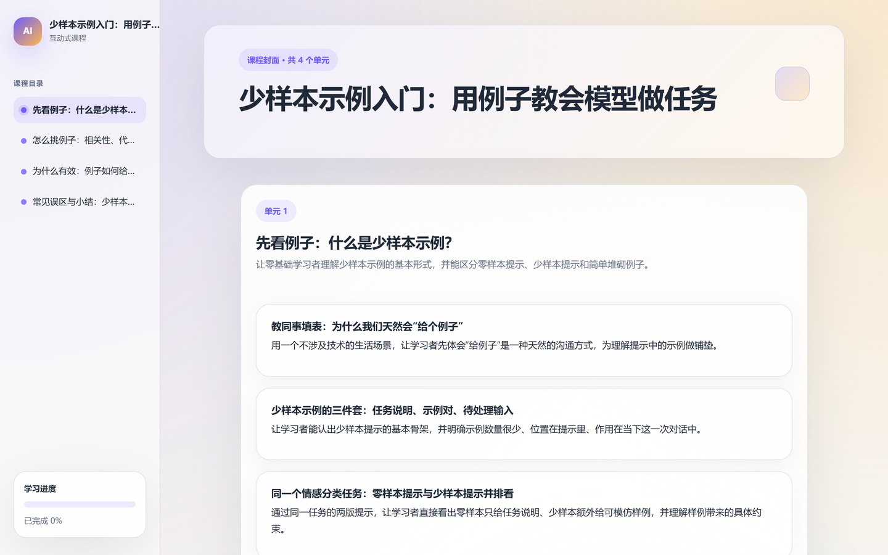
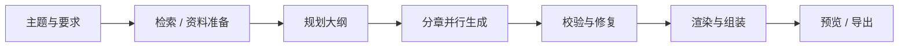

<div align="center">

# Content Generator Agent

**多模态教学内容生成工具：给一个主题，产出可学、可听、可发、可导出的教学资源。**


</div>

## 它是什么

一个可以独立运行的内容生成工具，也可以作为内容生成组件嵌入更大的教育系统。

输入主题和学习要求，它会完成大纲规划、分章写作、配图、排版和音频合成，输出五种教学资源。互动讲义还带答题与学习记录：学生的作答会持久化，学习摘要和薄弱点分析可以继续被其它系统消费。

一句话：**把“做一个教学资源”从几天的重复劳动，变成一次可配置的生成任务。**



*互动讲义：章节导航、分章讲解与互动题*

## 能生成什么

| 类型 | 产物 | 典型用途 |
|---|---|---|
| 互动讲义 | 单文件 HTML，分章节讲解 + 单选/多选/短答/情境讨论 | 学生自学、课后练习 |
| 播客 | 多人对谈脚本 + 按角色合成的 MP3 | 通勤听、课程音频 |
| 图文推文 | 封面、章节配图、公众号风格长文 | 知识分享、内容推送 |
| 讲义 | 分章节图文，支持 PDF / Markdown / HTML | 备课、系统学习材料 |
| 幻灯片 | 逐页内容与配图，支持 Slide JSON / PDF | 课堂演示、分享 |

互动讲义不是静态页面。学生答题、写短答、点提示都会产生学习事件，事件落库后可以查询、汇总，也可以导出成带答题记录的离线讲义。

## 怎么用

### 作为独立工具

打开工作台，选择内容类型，填写主题和生成要求，生成完成后在右侧预览，按需导出。历史记录里可以找回之前的任务，失败的图片或音频可以单独重试。

### 作为 HTTP API

```bash
curl -X POST http://localhost:8000/api/content-generation/tasks \
  -H "Content-Type: application/json" \
  -d '{
    "content_type": "interactive_html",
    "topic": "提示工程中的少样本示例",
    "user_prompt": "面向零基础学员，用 4 个章节讲解，并加入选择题和反思题。",
    "generation_options": { "difficulty": "introductory", "max_section_count": 4 }
  }'
```

返回 `task_id` 后可以轮询任务、读取预览、导出文件；互动讲义还可以创建学习会话、提交事件、获取摘要。

### 嵌入更大的教育系统

生成请求支持 `X-Platform-User-Id`、`X-Platform-Session-Id` 等上下文，以及 `knowledge_base_ids` 知识库参数；学习事件与摘要通过独立接口暴露，外部系统可以按自己的节奏消费。内容类型由注册表管理，新增一种内容不需要改工作流主干。

## 它是怎么工作的



- 单文档类型（推文、播客）一次成文；多章节类型（讲义、幻灯片、互动讲义）按章节并行生成。
- 每完成一章立即落库并推送到前端，不必等整篇结束。
- 单个章节或资源失败会先修复、再降级或记为失败资源，其它部分继续生成。
- 任务中断后重启会被标记，已生成的内容和预览保留。

## 学习记录

互动讲义的学习数据是这条工具链里最特别的一部分：

1. 学生答题或求助，前端提交学习事件；
2. 事件写入数据库，按章节、互动、事件类型保存；
3. 学习摘要计算完成度、正确率、求助次数、薄弱概念和复习章节；
4. adaptive brief 把薄弱点整理成新的生成要求，一键生成复习讲义。


*学习摘要：完成度、正确率、薄弱概念与复习入口*

这些数据也可以通过接口被外部系统读取，用于学习分析、推荐或画像更新。当前的 brief 由规则和模板生成，结果可解释、可测试，接口按 LLM 版本设计。

## 模块化

项目按职责拆分，各模块可以单独使用，也可以组合成完整链路：

- **内容类型注册表**：每种内容有独立的大纲约束、生成器、校验器和导出格式。
- **Provider 工厂**：文本、图片、语音可分别切换服务商，不绑死单一模型。
- **任务与资源仓储**：任务、产物、资源、引用分表存储，失败资源可单独重试。
- **学习服务**：会话、事件、摘要、brief 独立于生成流程，可按需启用。
- **导出器**：PDF、Markdown、HTML、Slide JSON、图片资源、音频各自独立。

## 快速开始

环境要求：Python 3.11+，Node.js 20+。

```bash
git clone https://github.com/Weilan0811/content-generator-agent.git
cd content-generator-agent

python -m venv .venv

# Windows PowerShell
.venv\Scripts\Activate.ps1
# macOS / Linux
# source .venv/bin/activate

pip install -r backend/requirements.txt

# 配置环境变量
cp .env.example .env            # Windows: copy .env.example .env

# 启动后端
uvicorn app.main:app --app-dir backend --port 8000

# 启动前端
cd frontend
npm install
npm run dev
```

打开 `http://localhost:5173`。

### 配置 `.env`

默认 `stub` 模式不调用外部服务，也不需要 Key，适合先跑通页面和流程。要看真实生成效果，把模式改为 `real`，并填好对应服务商的 Key：

```dotenv
CONTENT_GENERATOR_PROVIDER_MODE=real

# 文本模型（所有内容类型都需要）
CONTENT_GENERATOR_TEXT_PROVIDER=bailian
CONTENT_GENERATOR_TEXT_MODEL=qwen3.5-flash
CONTENT_GENERATOR_BAILIAN_API_KEY=sk-...

# 图片生成（讲义、幻灯片、图文推文需要）
CONTENT_GENERATOR_IMAGE_PROVIDER=apimart
CONTENT_GENERATOR_APIMART_API_KEY=sk-...

# 语音合成（播客需要）
CONTENT_GENERATOR_TTS_PROVIDER=bailian
CONTENT_GENERATOR_TTS_MODEL=qwen3-tts-flash
```

- 文本 provider 可选 `bailian` / `deepseek`，图片 provider 可选 `apimart` / `bailian`。
- 播客复用 `CONTENT_GENERATOR_BAILIAN_API_KEY`；互动讲义只需要文本能力。
- 数据库默认是仓库根目录下的 SQLite，首次启动自动建表；换 MySQL 时配置 `CONTENT_GENERATOR_DATABASE_URL` 或 `DB_*` 分组。
- 改完 `.env` 后重启后端生效。完整配置见 [.env.example](.env.example)。

## 项目结构

```
backend/app/
  api/            生成任务、资源重试、导出、学习会话
  content_types/  内容类型注册与各自的生成/校验规则
  workflows/      规划、并行生成、校验、渲染、组装
  services/       LLM/图片/TTS、任务与学习数据仓储、导出
  renderers/      幻灯片、互动讲义、离线讲义
  models/         任务、产物、资源、学习事件
frontend/         生成工作台、预览、历史记录、学习摘要
docs/             架构、互动讲义、学习闭环、集成契约、ADR
```

## 限制

知识库检索当前关闭（请求字段和检索接口已保留）；幻灯片版式与自动配图仍在打磨。

## 文档

| 文档 | 内容 |
|---|---|
| [docs/architecture.md](docs/architecture.md) | 分层、工作流、内容类型注册、存储与迁移 |
| [docs/interactive-lesson.md](docs/interactive-lesson.md) | 互动讲义从大纲到运行时、导出与离线讲义的契约 |
| [docs/learning-loop.md](docs/learning-loop.md) | 学习会话、事件、摘要、adaptive brief 的字段与算法 |
| [docs/platform-contract.md](docs/platform-contract.md) | 对外集成：请求头、知识库、学习数据与扩展字段 |
| [docs/adr.md](docs/adr.md) | 关键取舍：Composer、离线讲义、规则 brief 先行 |
| [docs/demo.md](docs/demo.md) | 演示录屏脚本与复现步骤 |
| [backend/README.md](backend/README.md) | 后端工程细节、接口与持久化 |
