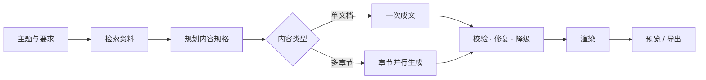

<div align="center">

# Content Generator Agent

**多类型学习内容生成引擎。给一个主题，产出可讲、可看、可追溯的内容。**


<!-- TODO: 演示 GIF 录好后放 docs/assets/，取消注释：

-->

*演示 GIF 占位——录制中*

</div>

## 这是什么

做一份能直接用的学习内容，通常要跨过几道工序：查资料、搭大纲、写正文、配插图、排版。这个项目把整条工序交给一条 LangGraph 工作流：输入主题与要求，引擎完成检索、规划、逐节写作与配图，产出图文讲义、幻灯片、交互式讲义、图文推文、播客脚本五类内容。

生成过程实时可见——章节在并行产出，每完成一章立即出现在预览里；生成结果有据可查——正文中的引用可以对应到来源资料；链路也经得起出错——单张配图失败、某个模型超时，任务会降级继续推进，而不是整体报废。

## ✨ 内容类型

| 类型 | 产物 | 适合做什么 |
|---|---|---|
| 📖 图文讲义（lecture） | 分章节讲解、学习目标、思考题 | 备课、系统自学材料 |
| 🎞️ 幻灯片（slide_deck） | 逐页大纲与页面内容 | 课堂演示、分享汇报 |
| 🧩 交互式讲义（interactive_html） | 内嵌测验与可交互元素的单文件 HTML | 概念演示、课后练习 |
| 📰 图文推文（social_post） | 封面图、章节配图与排版好的长文 | 公众号等知识分享 |
| 🎙️ 播客脚本（podcast_script） | 多人对谈式讲稿 | 知识播客、通勤伴听 |

各类型支持 HTML / Markdown / PDF 等一种或多种导出格式；任务规格和产物保存到数据库，任务事件和日志保存在本地文件中。

## 亮点

### 👀 生成过程全程直播

- **SSE 流式进度**：后端持续推送状态与进度快照，前端经 EventSource 订阅，轮询仅作兜底。
- **章节并行、逐个可见**：多章节内容在线程池中并行生成，每完成一章立即落库并更新预览，而不是全部结束后一次性给出。

### 🧗 经得起出错

- **三级降级**：内容校验不过先自动修复重写，仍不过时按开关降级产出，两者都不可行才判定任务失败。
- **配图占位兜底**：某张配图生成失败时自动替换为占位图，失败原因写入元数据，任务继续推进。

### 📎 有据可查

- **引用留痕**：生成内容中的引用会记录来源资料与位置，随导出一并呈现。
- **过程可追溯**：节点输入输出保存在调试文件中，任务事件和日志保存在本地文件中。

### 🔌 模型与检索可插拔

- **四个环节独立可换**：文本、配图、语音、检索均为 provider 工厂模式，`.env` 一行切换服务商。
- **零配置起步**：默认 stub 模式不依赖任何 API Key，即可跑通全流程；接入真实模型只需复制 `.env.example` 填入 Key。

## 🚀 快速开始

环境要求：Python 3.11+，Node.js 20+。

```bash
git clone https://github.com/Weilan0811/content-generator-agent.git
cd content-generator-agent

# 后端（默认 stub 模式，无需 API Key）
python -m venv .venv && source .venv/bin/activate    # Windows: .venv\Scripts\activate
pip install -r backend/requirements.txt
uvicorn app.main:app --app-dir backend

# 前端
cd frontend
npm install
npm run dev
```

打开 `http://localhost:5173`，输入一个主题即可开始生成。要使用真实模型，复制 `.env.example` 为 `.env`，填入所用服务商的 Key 后重启后端。

## ⚙️ 工作原理



单文档类型（推文、播客脚本）一次成文；多章节类型（讲义、幻灯片、交互式讲义）按章节并行生成，逐个校验与修复。持久化模型、降级矩阵、接口契约等工程细节见 **[backend/README.md](backend/README.md)**。

## 🗺️ 开发计划

- ✅ 五类内容生成、双通路工作流、三级降级、配图占位兜底
- ✅ SSE 流式进度与章节级实时落库
- 🔭 本地知识库：BM25 + 向量混合检索与召回率评测，替代外部知识库服务
- 🔭 内容质量评测：LLM-as-judge 评分体系与 badcase 集
- 🔭 知识演化：LLM Wiki 式的 ingest / lint / 双链最小闭环
- 🔭 更多内容类型与导出格式

## 📚 文档

| 文档 | 内容 |
|---|---|
| [docs/introduction.md](docs/introduction.md) | 项目设计与背景 |
| [backend/README.md](backend/README.md) | 后端架构、接口、持久化与开发约定 |
