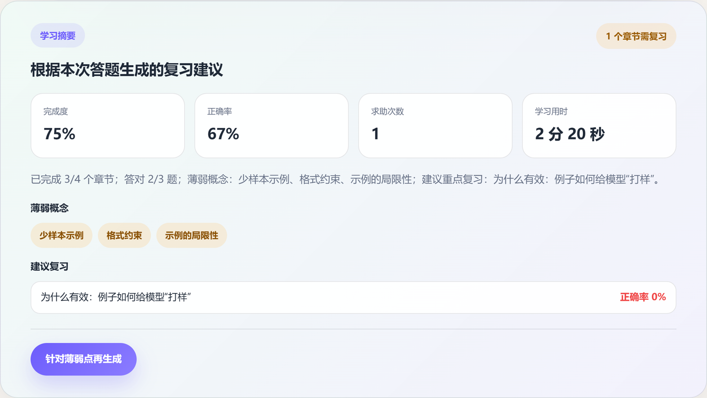
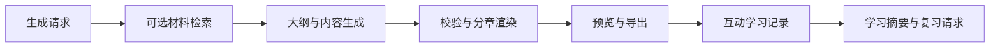

# Content Generator Agent

多模态教学内容生成工具。输入主题和学习要求，生成可预览、可导出、可继续学习的教学资源。

项目可以独立运行，也可以通过 HTTP API 接入教育平台。后端使用 FastAPI、LangGraph 和 SQLite，前端使用 React 与 TypeScript。


## 能做什么

| 内容类型 | 主要输出 |
|---|---|
| 互动讲义 | 分章 HTML、互动题、学习摘要、带答题记录的离线讲义 |
| 讲义 | 分章图文、PDF、Markdown、HTML |
| 幻灯片 | 逐页内容、配图、Slide JSON、PDF |
| 播客 | 多角色脚本、语音分段、完整音频 |
| 图文推文 | 长文、封面和章节配图 |

生成中的章节会逐步显示。任务历史保存在数据库中，失败的图片或语音可以单独重试。互动讲义支持记录作答、统计薄弱知识点，并按原始材料和生成设置创建复习讲义。

## 快速开始

需要 Python 3.11+、uv 和 Node.js 22.12+。以下命令均从仓库根目录开始。

```powershell
uv sync --group dev
Copy-Item .env.example .env
```

macOS、Linux 可以使用 `cp .env.example .env`。

编辑 `.env`，切换到真实生成模式并填写所需 API Key：

```dotenv
CONTENT_GENERATOR_PROVIDER_MODE=real
CONTENT_GENERATOR_TEXT_PROVIDER=bailian
CONTENT_GENERATOR_TEXT_MODEL=qwen3.5-flash
CONTENT_GENERATOR_BAILIAN_API_KEY=填写你的百炼Key
```

| 能力 | 配置要求 |
|---|---|
| 文本生成 | 所有类型都需要；支持百炼或 DeepSeek |
| 图片生成 | 讲义、幻灯片、图文推文需要；支持 APIMart 或百炼 |
| 语音生成 | 播客需要；使用百炼语音服务 |
| 知识库 | 可选；默认关闭，基本启动流程不需要下载向量模型或建立索引 |

服务商选择、模型名称和其余参数见 [.env.example](.env.example)。不要提交填有真实凭据的 `.env`。

启动后端：

```powershell
uv run python -m uvicorn app.main:app --app-dir backend --host 127.0.0.1 --port 8000
```

另开一个终端启动前端：

```powershell
cd frontend
npm ci
npm run dev
```

打开 <http://127.0.0.1:5173>。API 文档位于 <http://127.0.0.1:8000/docs>。SQLite 首次启动自动建表，生成文件写入 `storage/`。

改动 `.env` 后重启后端。仅验证页面和接口时，可以明确选择 `CONTENT_GENERATOR_PROVIDER_MODE=stub`；该模式不生成真实教学内容。知识库有独立开关，启用后仍需要实际检索依赖和模型。

## 基本使用

1. 在工作台选择内容类型，填写主题、受众和生成要求。
2. 查看生成进度和逐章预览，完成后导出所需格式。
3. 从历史记录重新打开任务，在对应资源位置重试失败的图片或语音。
4. 在互动讲义中作答，查看学习摘要，生成针对薄弱点的复习内容。



## API 接入

向 `POST /api/content-generation/tasks` 提交生成请求：

```json
{
  "content_type": "interactive_html",
  "topic": "如何使用教学内容工作台",
  "user_prompt": "面向初次使用者讲解任务生成、预览与资源重试，并加入检查理解的题目。",
  "generation_options": {"difficulty": "introductory", "max_section_count": 3}
}
```

返回的 `task_id` 可用于查询进度、读取预览和导出资源。平台上下文、学习事件与集成契约见 [平台接口说明](docs/platform-contract.md)。

## 可选知识库

项目提供自托管知识库能力：添加自己的 Markdown 材料，建立关键词和向量索引，再让内容生成流程检索这些材料。也支持只检索单个任务附带的材料，或与平台知识库融合检索。

仓库包含自行编写的[使用说明示例](knowledge/examples/workbench-guide.md)，不附带外部语料、模型权重和实验数据。

- 安装、配置、建库和增删材料：[知识库使用说明](knowledge/README.md)。
- 分块、融合、过滤和材料隔离的设计依据：[知识库设计](docs/knowledge-base-design.md)。

## 项目结构与设计

后端按 API、请求契约、工作流、服务、渲染和存储分层。知识库引擎独立于后端，通过检索适配器提供片段和检索状态。



| 文档 | 内容 |
|---|---|
| [架构](docs/architecture.md) | 模块职责、工作流与持久化 |
| [后端说明](backend/README.md) | 服务接口与实现细节 |
| [互动讲义](docs/interactive-lesson.md) | 在线互动与离线讲义 |
| [学习记录](docs/learning-loop.md) | 会话、摘要及复习生成 |
| [设计决策](docs/adr.md) | 主要工程取舍 |
| [贡献说明](CONTRIBUTORS.md) | 作者归属及第三方组件 |

## 开发检查

```powershell
uv run python -m pytest backend/tests/test_kb_runtime.py backend/tests/test_learning_persistence.py backend/tests/test_learning_summary.py
cd frontend
npm run build
```

知识库默认不参与基本启动。开启真实生成后，模型响应、生成时间和费用取决于服务商配置。幻灯片版式及自动配图仍有改进空间。
