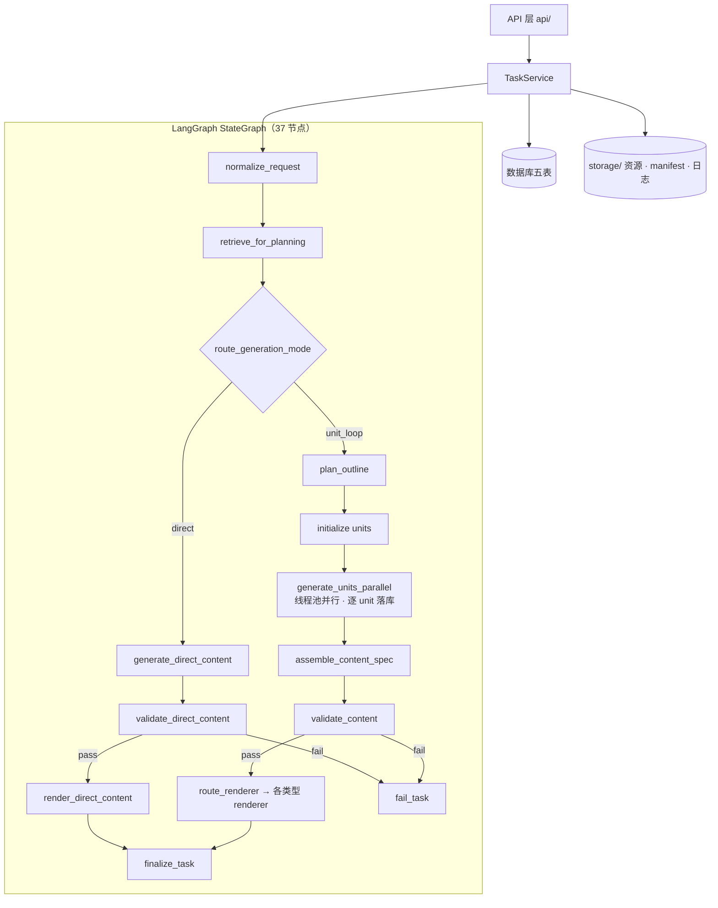

# Content Generator Agent Backend

后端是内容生成引擎的执行层：接收生成请求，编排知识库检索、LLM 结构化生成、图片生成与 TTS，产出可预览、可追溯、可导出的内容结果。基于 FastAPI 暴露 HTTP API，LangGraph 编排生成 workflow，Pydantic schema 约束全部数据契约，SQLModel 将任务状态持久化到数据库。

## 架构总览



**两条生成通路**，由内容类型决定：

| | direct 通路 | unit_loop 通路 |
|---|---|---|
| 适用类型 | `social_post`、`podcast_script` | `lecture`、`slide_deck`、`interactive_html` |
| 生成方式 | 一次产出完整 spec，经校验后渲染 | 大纲规划 → 章节 unit 并行生成 → 汇总校验渲染 |
| 校验失败处理 | pass / fail 两分支，直接失败 | spec 级与 render 级各有 repair / fallback 循环 |
| 典型耗时 | 数十秒 | 数分钟（章节数 × 单章生成） |

一个值得知道的实现细节：unit 级节点（`generate_unit_spec`、`render_unit` 及其 repair / fallback）虽在图上注册，但真实执行由 `workflows/parallel_units.py` 的线程池调度，LangGraph 只调度到 `generate_units_parallel` 为止。修改 unit 级行为需同时覆盖单发与并行两条路径。完整节点清单与状态流转见 [docs/content_generation_workflow.md](../docs/content_generation_workflow.md)。

## 工程设计

### 任务生命周期与持久化

任务创建后进入后台执行，工作流每完成一个节点就保存任务状态和产物；unit_loop 通路中，**每完成一个章节立即保存**，因此部分预览在生成中途就逐章出现。数据库包含五张 SQLModel 表：

| 表 | 内容 |
|---|---|
| `content_generation_task` | 任务状态、进度与请求信息 |
| `content_generation_artifact` | 大纲、内容规格、章节与预览产物 |
| `content_generation_asset` | 资源记录 |
| `content_generation_reference` | 任务和知识片段的引用关系 |
| `knowledge_chunk_cache` | 知识片段正文缓存 |

平台侧继续保持"一会话一主产物"规则，生成模块通过 `platform_log_id`、`platform_user_id`、`platform_session_id` 与平台侧记录关联，不建立跨库外键。

### 三级降级

校验失败不会立即终止任务，降级路径按层次展开：

- **spec 级**（unit_loop）：`validate_unit_spec` 不过 → 自动修复重写一次 → 仍不过且 `allow_fallback` 开启时降级为确定性兜底 spec。
- **render 级**（unit_loop）：单章渲染校验不过 → `repair_render_unit` → `fallback_render_unit`。
- **配图级**（所有通路）：单张配图生成失败时自动替换为占位图，失败原因写入元数据与 spec，任务继续推进。

三级都不可行才进入 `fail_task`。这是刻意的取舍：direct 通路（`social_post` / `podcast_script`）目前只有 pass / fail 两分支，尚未接入 repair 循环，是后续要补齐的部分。

开关约定：真实模式默认**不静默 fallback**，便于暴露 provider、schema 和渲染错误；demo 场景可设置 `CONTENT_GENERATOR_ALLOW_FALLBACK=true` 或在请求的 `generation_options.allow_fallback` 中开启。

### 实时进度

- **SSE 流式端点**：`GET /api/content-generation/tasks/{task_id}/events/stream` 以约 600ms 一帧推送轻量快照（状态、progress、unit 与事件计数），空闲期发送 keep-alive 帧，任务终态发送 `done` 帧后关闭。
- **前端订阅**：EventSource 优先，连接失败自动回退轮询；计数无变化时跳过 units / partial 预览的重复拉取。
- **任务记录**：事件保存在 `storage/logs/content-generation/{task_id}.events.json`，任务日志写入同目录；`storage/debug_workflow/{task_id}/steps/` 保存节点输入输出。指标接口目前返回空列表。

### Provider 工厂

文本、配图、语音、检索四个环节均为工厂模式，互不耦合：

| 环节 | stub 行为 | real 实现 |
|---|---|---|
| LLM | 返回结构化假数据 | 百炼 OpenAI 兼容接口，JSON schema 约束 + repair + 重试 |
| 图片 | 本地 SVG 占位图 | APIMart / 百炼 DashScope 原生异步 API（提交 → 轮询 → 下载），429 限流退避 |
| TTS | 静音音频 | 百炼 `qwen3-tts-instruct-flash` |
| 检索 | 关闭，返回空片段 | 本地知识库：自备语料 + BM25/向量混合检索（`CONTENT_GENERATOR_KB_PROVIDER=local`） |

`CONTENT_GENERATOR_PROVIDER_MODE=stub` 时全链路不依赖任何外部服务，可在无 API Key 的环境跑通完整 workflow，用于本地开发、CI 与前端联调。

检索层默认关闭（`kb_provider=external` 视为无可用知识库，返回空片段、不生成占位引用，任务和预览响应标记 `knowledge_base.status=disabled`）。设置 `CONTENT_GENERATOR_KB_PROVIDER=local` 后切换到自托管知识库模块：本地 BM25 + 向量混合检索，引擎与评测管线见根 README 的「知识库引擎」章节。

生成请求可附带用户自己的材料（`attachments: [{filename, content}]`，md/txt 纯文本，≤10 个、单个 ≤200KB），并通过 `kb_mode` 选择检索范围：

| kb_mode | 行为 |
|---|---|
| `platform`（默认） | 只检索平台知识库，与历史行为完全一致 |
| `materials_only` | 只检索本次任务附带材料（无附件时请求被拒绝） |
| `fused` | 平台库与材料各自检索后加权 RRF 融合（权重 1.0/1.3，材料略优先）；无附件时静默降级为 platform |

实现要点：材料进入**任务级独立命名空间**——一次性 BM25 现场构建（不落盘）+ 内存余弦检索（embedding 按 content hash 缓存，同一材料不重复计费）。小命名空间不值得写共享索引；持久的个人知识库（多租户）再迁入统一 collection + scope filter。`Chunk.scope` 区分 `platform` / `attachment` / `wiki`，引用元数据透传 scope，隔离红线：平台模式召回结果中不得出现任务材料（有红队用例验证）。

### Schema 真源

请求、状态、spec、render model、导出结果、资源元数据全部由 Pydantic schema（v2）定义；`scripts/export_json_schema.py` 将关键 schema 导出到 `schema_exports/`，前后端字段契约以此为唯一事实来源，不靠口头约定。

## 当前能力概览

| 能力 | 当前状态 | 说明 |
|---|---|---|
| API 服务 | 已具备基础闭环 | 任务创建/查询、事件查询与 SSE 流、完整/局部/单元预览、导出、资源查询下载、互动学习事件接口。 |
| 任务系统 | 已接入持久化 | 数据库保存任务和内容产物，本地文件保存事件、日志和资源。 |
| Workflow 编排 | 已接入 LangGraph | 请求标准化、知识库检索、生成模式路由、outline 规划、unit loop、元素生成、单元级渲染、校验、repair / fallback 和失败路径。 |
| 实时进度 | 已支持 SSE | `events/stream` 流式推送 + 章节 unit 逐个落库，前端 EventSource 订阅、轮询兜底。 |
| 内容类型 | 支持 `lecture`、`slide_deck`、`interactive_html`、`social_post`、`podcast_script` | 前三者走 unit-loop workflow；后两者走 direct workflow。 |
| 内容类型注册 | 已具备 registry 机制 | `app/content_types/` 统一声明生成模式、schema、renderer、generator、元素策略和导出格式。 |
| 检索服务 | 本地知识库 + 任务级材料 | 本地 BM25+向量混合检索（评测见 `knowledge/eval`）；支持任务附件三种 kb_mode（platform / materials_only / fused）。 |
| LLM 服务 | 支持 stub 与百炼兼容 OpenAI structured output | real 模式支持 JSON schema 约束、repair、重试、超时和 usage 记录。 |
| 图片服务 | 支持 stub、APIMart、百炼图片生成 | stub 模式生成本地 SVG 占位图；real 模式生成远程图片并保存为本地 asset；生成失败的 slot 自动降级为占位图。 |
| TTS 服务 | 支持 stub 与百炼 Qwen-TTS | real 模式使用 `qwen3-tts-instruct-flash`，固定 `Person1 -> Ethan`、`Person2 -> Cherry`。 |
| 互动学习事件 | 已有 P0 in-memory 实现 | `app/api/learning.py` 提供 session 创建、学习事件提交和 session state 查询，用于 `interactive_html` 在线学习记录和离线讲义导出。 |
| Renderer | 已有五类 renderer | lecture 输出阅读预览；slide 输出 `scenekit.slide/v1`；interactive_html 输出 `interactive_html_page`；social_post 输出 WeChat article HTML 与 article JSON；podcast 输出脚本、分段音频、manifest 和完整音频。 |
| Exporter | 已有 PDF / Slide JSON / HTML / Image Assets / Markdown / Audio | PDF 当前为占位导出；Slide JSON、HTML、image assets、markdown、audio 已可落盘并返回下载 URL。 |
| Schema 导出 | 已具备 | `scripts/export_json_schema.py` 可将关键 Pydantic schema 导出到 `schema_exports/`，便于前端对齐类型。 |

## 目录结构

```text
backend/
├── app/
│   ├── main.py                         # FastAPI 应用入口
│   ├── api/                            # HTTP API：content generation / assets / learning
│   ├── content_types/                  # 内容类型 profile 注册表
│   ├── core/                           # 配置、数据库、日志、异常、调试产物
│   ├── models/                         # SQLModel 数据库模型
│   ├── schemas/                        # Pydantic 数据契约
│   ├── services/                       # 可替换服务层：task / rag / llm / image / storage / tts / learning
│   ├── workflows/                      # LangGraph workflow 与 nodes
│   ├── generators/                     # 内容 spec 生成逻辑
│   ├── renderers/                      # Spec -> RenderModel / HTML fragment
│   ├── exporters/                      # RenderModel -> 可下载文件
│   ├── validators/                     # 本地校验器
│   ├── prompts/                        # planner / generator / reviewer prompts
│   └── skills/                         # 外部 skill 适配资源，例如 wechat-claw-skill
├── alembic/                            # 数据库迁移
├── schema_exports/                     # 已导出的 JSON Schema
├── scripts/                            # 工具脚本
└── tests/                              # 单元测试与 workflow 调试测试
```

## 快速启动

```bash
cd backend
python -m uvicorn app.main:app --reload --host 127.0.0.1 --port 8000
```

启动后访问：

```text
http://127.0.0.1:8000/health
http://127.0.0.1:8000/docs
```

本地开发默认建议先使用 stub 模式：

```env
CONTENT_GENERATOR_PROVIDER_MODE=stub
CONTENT_GENERATOR_DATABASE_URL=sqlite:///./content_generator.db
CONTENT_GENERATOR_STORAGE_ROOT=storage
```

接入真实服务时再配置：

```env
CONTENT_GENERATOR_PROVIDER_MODE=real
CONTENT_GENERATOR_BAILIAN_API_KEY=...
CONTENT_GENERATOR_BAILIAN_BASE_URL=https://dashscope.aliyuncs.com/compatible-mode/v1
CONTENT_GENERATOR_BAILIAN_TTS_BASE_URL=https://dashscope.aliyuncs.com
CONTENT_GENERATOR_APIMART_API_KEY=...
CONTENT_GENERATOR_KB_API_BASE_URL=...
CONTENT_GENERATOR_KB_API_KEY=...
```

默认图片 provider 为 APIMart `gpt-image-2`，会轮询任务结果并把图片转存到 Local storage；百炼图片 provider 可通过 `CONTENT_GENERATOR_IMAGE_PROVIDER=bailian` 切换。

## API 一览

| 分组 | 端点（前缀 `/api`） |
|---|---|
| 任务 | `POST /content-generation/tasks` · `GET /content-generation/tasks/{id}` · `GET …/preview`（完整/局部） · `GET …/units`（列表/单元预览/单元文本） · `GET …/events` · `GET …/events/stream`（SSE） · `POST …/export` |
| 产物 | `GET …/artifacts`（列表/详情） · `GET …/outline` · `GET …/references`（任务级/单元级） · `GET …/metrics` |
| 资源 | `GET /assets/{id}` · `GET /assets/{id}/download` |
| 互动学习 | `POST /interactive-lessons/{lesson_id}/sessions` · `POST …/sessions/{id}/events` · `GET …/sessions/{id}/state` |

完整请求响应结构见 [docs/api.md](../docs/api.md)。

## 示例请求

### 生成互动式 HTML 课件

```json
{
  "content_type": "interactive_html",
  "topic": "生成式 AI 如何理解你的问题？",
  "user_prompt": "面向初学者生成一份纵向教材式 + 对话导师的互动 HTML 课件，包含单选、多选、简答和情景讨论。",
  "knowledge_base_ids": ["default"],
  "generation_options": {
    "language": "zh-CN",
    "audience": "AI 初学者",
    "difficulty": "introductory",
    "style": "educational",
    "section_count": 5,
    "output_depth": "standard",
    "allow_fallback": true
  }
}
```

`interactive_html` 生成完成后，完整预览接口返回 `InteractiveHtmlRenderModel`，其中 `render_type = "interactive_html_page"`，`sections` 中包含每个单元的 `html_fragment`、`css_fragment`、`block_manifest` 和 `interaction_manifest`。

### 创建互动学习 Session

```http
POST /api/interactive-lessons/{lesson_id}/sessions
```

### 导出离线复习讲义

```json
{
  "export_type": "html",
  "export_options": {
    "session_id": "session_xxxxxxxxxxxx"
  }
}
```

离线讲义会读取该 session 已提交的学习事件，把在线互动控件静态化，并附带答题记录。

## 数据库

任务和产物分布在五张表（见「工程设计 → 任务生命周期与持久化」）。SQLite 本地开发在启动时自动执行 Alembic 迁移，初始化表结构并记录版本；重复启动或手动执行迁移不会重复添加字段。MySQL 等数据库启动前执行相同的 Alembic 迁移：

```bash
cd backend
alembic upgrade head
```

## 常用命令

```bash
# 运行测试（默认 stub / mock，不调用 APIMart、百炼或真实 Qdrant 服务）
pytest -q

# Windows 受限环境下若 pytest 临时目录报权限错误，用项目虚拟环境直接运行
.\.venv\Scripts\python.exe -m pytest backend/tests -q -p no:cacheprovider

# 调试 slide workflow
pytest tests/test_workflow_debug.py::test_slides -q -s -p no:cacheprovider

# 互动 HTML 相关测试
pytest tests/test_interactive_html_renderer.py tests/test_interactive_html_validator.py tests/test_interactive_html_handout.py tests/test_interactive_html_prompts.py -q

# 导出前后端对齐用 JSON Schema
python scripts/export_json_schema.py
```

Windows PowerShell 调用 API 时建议使用 `Invoke-RestMethod`，避免把 Linux `curl -H -d` 写法直接复制到 PowerShell 中。

## Workflow 调试测试

`backend/tests/test_workflow_debug.py` 是手动真实生成调试测试，不属于默认稳定测试入口。运行前请确认：

- `.env` 已配置真实 provider 所需 API key，并设置 `CONTENT_GENERATOR_PROVIDER_MODE=real`。
- 知识库检索当前关闭，不需要配置外部 KB 服务。
- 真实图片生成可能产生外部 API 调用和费用。

```powershell
$env:CONTENT_GENERATOR_PROVIDER_MODE="real"
.\.venv\Scripts\python.exe -m pytest backend/tests/test_workflow_debug.py::test_lecture -q -s -p no:cacheprovider
```

测试会在 stdout 显式打印 workflow 每一步输出，并把调试结果保存到 `storage/debug_workflow/<request_id>/`：

- `steps/NN_<node>.json`：每个 LangGraph 节点的 update 输出。
- `trace.json`：按顺序汇总的节点输出。
- `final_state.json`、`content_spec.json`、`render_model.json`、`elements.json`：最终工作流产物。
- `assets/`、`generated_assets.json`：真实生成资产及 manifest。

## 核心开发约定

**内容类型扩展**

1. 新内容类型需要优先在 `app/content_types/` 注册 profile，再补齐 schema、prompt、generator、renderer、validator 和 exporter。
2. 前后端字段契约以 Pydantic schema、OpenAPI 和 `schema_exports/` 为准。

**生成与校验**

3. 内容生成请求统一进入 `POST /api/content-generation/tasks`，由 `TaskService` 创建任务并触发 LangGraph workflow。
4. `lecture`、`slide_deck`、`interactive_html` 采用 `outline -> unit spec -> unit render -> content spec -> render model` 的 unit-loop 生成路径。
5. `social_post` 和 `podcast_script` 采用 direct 生成路径，生成完整 spec 后直接校验、渲染与导出。
6. Generator 输出必须经过 Pydantic schema 校验，必要时走 repair 或 deterministic fallback。
7. Validator 负责保护结构闭合、引用覆盖、元素闭合、HTML 安全约束和内容质量，不把明显不可渲染的 spec 或 fragment 继续传给后续节点。
8. 修改 unit 级行为（spec / render / repair / fallback）时，需同时覆盖单发路径与 `parallel_units.py` 的并行路径。

**渲染与导出**

9. `interactive_html` 的 Unit Spec 只描述教学设计和互动规格，禁止输出 HTML / CSS；单元渲染阶段再生成讲解 HTML/CSS，并通过模板插入互动题。
10. Renderer 负责把 spec 转成前端可消费的 render model；`interactive_html` 的单元级 composer 会调用 LLM 生成非互动讲解片段，互动控件仍由后端模板稳定生成。
11. Exporter 只负责把 render model 落盘为文件；`interactive_html` 的 `html` 导出依赖 learning session 的事件记录。

**可观测与存储**

12. workflow 每个关键节点需要更新 `current_node`、`progress`、`stream_events` 或 `logs`，便于前端流式展示进度；unit_loop 通路的章节完成即落库。
13. 本地资源统一通过 `LocalStorageService` 写入 `storage/files/`，资源元数据写入 `storage/manifest.json`。

## 文档索引

| 文档 | 内容 |
|---|---|
| `docs/api.md` | 后端 API、请求响应结构、互动学习接口、导出接口、前后端联调示例。 |
| `docs/content_generation_workflow.md` | 内容生成 LangGraph workflow、节点职责、状态流转、unit-loop / direct 路由和扩展约定。 |
| `docs/interactive_html_generation.md` | 互动式 HTML 课件生成链路、schema、prompt、模板渲染、校验、学习事件和离线讲义导出约定。 |
| `docs/social_post_generation.md` | 微信公众号推文生成链路、schema、prompt、图片规划、渲染导出约定。 |
| `docs/podcast_generation.md` | 播客生成链路、schema、TTS、音频拼接、重试和导出约定。 |
| `docs/development_notes.md` | 环境变量、调试方式、测试、数据库、常见问题和后续开发注意事项。 |

## 当前注意事项

- `pdf` exporter 当前仍是占位 PDF，后续需要接入真实 PDF 渲染。
- `slide_deck` 当前稳定输出 `slide_json`，`pptx` 字段已预留但 exporter router 尚未完成真实实现。
- `lecture` 当前以阅读预览模型为主，打印/PDF 模型仍需继续增强。
- `social_post` 当前只实现微信公众号文章，不覆盖微博、小红书、Twitter/X 等平台。
- `podcast_script` 当前支持双人中文播客脚本和音频生成，不包含背景音乐、混音、降噪和剪辑器能力。
- `interactive_html` 当前支持在线 render model、P0 四类互动模板和离线 HTML 讲义导出；学习 session 与事件存储仍是 in-memory，实现持久化前不适合跨进程或服务重启后的生产使用。
- `interactive_html` profile 中声明了 `zip`，但当前 `ExportType` 和 exporter router 尚未接入 `zip`，API 层可用导出以 `html` 为准。
- 前端暂时无法持久化记录答题答案（答案可随意修改），与交互设计预期不符，优先级不高，待 learning session 持久化一并解决。
