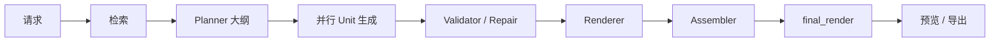

# 架构

## 分层

```
frontend/            React + TypeScript 工作台、历史记录、预览与导出
backend/app/
  api/               HTTP 路由（生成任务、资源、导出、学习会话）
  schemas/           Pydantic 请求/响应、规格（spec）、渲染（render）契约
  content_types/     内容类型注册表与 profile（大纲约束、导出格式、校验器）
  workflows/         LangGraph 风格工作流、节点、路由与降级
  services/          LLM/图片/TTS、任务仓储、资源重试、学习服务、导出
  renderers/         幻灯片、互动讲义 Composer、离线讲义
  exporters/         PDF / Markdown / HTML / 音频 / 图片资源
  models/            SQLModel 表
alembic/             数据库迁移
storage/             SQLite、导出文件、日志、调试快照
```

前端只依赖后端 HTTP 契约；内容渲染以 `render_model` 为准，不读取工作流内部状态。

## 内容类型

注册表位于 `backend/app/content_types/registry.py`，当前注册：

| 类型 | 主要产物 | 典型导出 |
|---|---|---|
| `interactive_html` | 单文件互动讲义（章节 HTML/CSS + 运行时清单） | HTML、离线讲义、PDF |
| `podcast_script` | 多人对谈脚本 + 分段音频 | 音频（MP3）、Markdown |
| `social_post` | 封面、章节配图、长文 | Markdown、HTML、图片资源 |
| `lecture` | 分章节图文讲义 | Markdown、PDF、HTML |
| `slide_deck` | 逐页幻灯片 JSON 与图片 | Slide JSON、PDF、图片资源 |

每种类型由 `ContentTypeProfile` 描述大纲约束、单元生成器、校验器与可用导出类型。新增类型只需实现 profile 并注册，不修改工作流主干。

## 工作流



- **单文档类型**（推文、播客）一次成文。
- **多章节类型**（讲义、幻灯片、互动讲义）按单元并行生成，每完成一个单元立即写入 `unit_render` artifact，前端可增量预览。
- 每个单元失败会先修复重写；仍失败时按配置降级或记录失败资源，不影响其它单元。
- `stream_content_generation` 持续产出状态快照，`PersistentTaskService` 将其落库并写入任务事件。

## 状态与产物

- `content_generation_task`：任务状态、进度 JSON、请求参数、平台上下文。
- `content_generation_artifact`：`outline`、`content_spec`、`unit_render`、`partial_render`、`final_render`。
- `content_generation_asset`：图片、音频等资源，含状态、错误、重试次数。
- `content_generation_reference`：检索片段引用。
- `interactive_learning_session` / `interactive_learning_event`：学习会话与事件。

SQLite 启动时由 `SQLModelTaskRepository` 执行 Alembic `upgrade head`；无版本记录的旧库会自动 stamp 到基线后升级。MySQL 走同一套迁移。

## 任务恢复与资源重试

- 进程重启时，运行中的任务标记为 `interrupted`，保留已生成的单元与预览。
- 失败资源可通过 `GET /tasks/{id}/failed-resources` 查看，`POST /tasks/{id}/resources/{resource_id}/retry` 单资源重试，不必重跑整个任务。
- SSE：`GET /api/content-generation/tasks/{id}/events/stream` 推送轻量进度快照。

## 关键接口

| 接口 | 说明 |
|---|---|
| `POST /api/content-generation/tasks` | 创建生成任务 |
| `GET /api/content-generation/tasks` | 分页、按类型/状态筛选 |
| `GET /api/content-generation/tasks/{id}/preview` | 最终预览 |
| `GET /api/content-generation/tasks/{id}/preview/partial` | 生成中的部分预览 |
| `GET /api/content-generation/tasks/{id}/units` | 单元快照 |
| `POST /api/content-generation/tasks/{id}/export` | 导出 |
| `GET /api/content-generation/tasks/{id}/failed-resources` | 失败资源列表 |
| `POST /api/content-generation/tasks/{id}/resources/{rid}/retry` | 重试单个资源 |

学习相关接口见 [learning-loop.md](learning-loop.md)。

## 自建知识库

`knowledge/engine` 提供独立的切分、关键词／向量索引和检索能力，`LocalKBService` 负责后端适配。平台材料与任务附件分别检索；仅附件模式不依赖平台索引。建库和文档增删由明确的维护命令执行，单个本地 Qdrant 目录使用单进程访问。

使用说明见 [知识库文档](../knowledge/README.md)，设计依据见 [知识库设计](knowledge-base-design.md)。语料、索引和实验资料不随公开版本分发。
