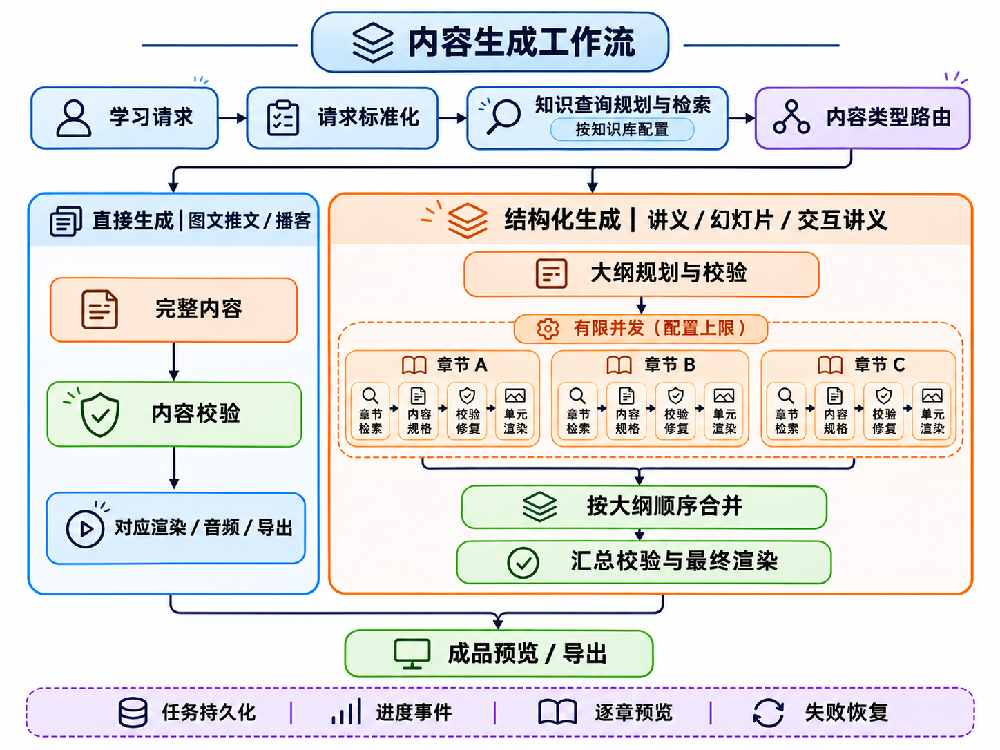
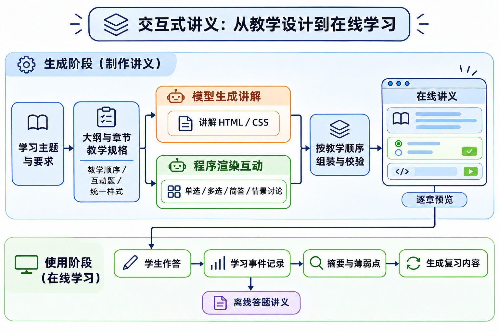

# 架构与开发指南

Content Generator Agent 提供内容生成与交互学习能力。使用者提交主题和要求，后端规划内容、准备资料并生成产物，前端负责阅读、互动、学习记录和导出入口。系统既可独立运行，也可通过接口接入其他应用。

安装与供应商配置见[配置指南](configuration.md)。

## 1. 一次生成如何进行



入口将请求转换为统一结构，再按内容类型选择生成方式：

| 生成方式 | 内容类型 | 处理过程 |
| --- | --- | --- |
| 整篇生成 | 图文推文、播客 | 轻量规划、生成完整内容规格、校验与渲染 |
| 分单元生成 | 图文讲义、幻灯片、交互讲义 | 大纲规划、各单元查询与生成、校验、渲染和有序汇总 |

内容规格描述“要呈现什么”，渲染模型描述“页面如何显示”。前端读取渲染模型，不读取工作流内部状态。

LangGraph 负责节点和条件流转。分单元流程可以并发处理章节，完成一个单元就保存其渲染结果，供前端提前预览；最终仍按大纲顺序组装。结构和渲染校验各有相应修复路径，修复次数有限，各类型不共享完全相同的处理步骤。

## 2. 交互讲义的生成与学习



交互讲义分三层生成：

1. **大纲：** 确定章节、学习目标、概念和关键问题。
2. **单元规格：** 组织教学顺序、讲解内容和互动题目。
3. **页面组装：** 生成受限的讲解 HTML/CSS，按教学顺序加入程序提供的互动组件，输出章节和互动清单。

讲解内容允许模型选择表达方式；选项、作答事件和运行时行为由程序统一处理。生成的 HTML/CSS 经过检查，页面外壳、导航和事件上报由前端负责。

当前正式互动规格包含单选、多选、简答和情景讨论。单选、多选有答案判定，文本提交按实际事件保存。配对、排序等教学块或历史事件名称不代表所有类型都具有相同的评分能力。

学习事件保存章节、互动编号和作答内容。学习服务按事件计算正确率、求助次数和薄弱概念，未评分回答不计入正确率分母。复习请求读取原始任务配置，追加薄弱点要求并提交新生成任务，沿用材料、检索方式和其他生成选项。

## 3. 知识查询如何支持内容生成

启用本地知识库后，查询在两个位置发生：

1. 大纲生成前，文本模型根据学生主题、要求和生成参数提出 1—4 条查询，并说明用途。执行查询后合并资料，供模型规划大纲。
2. 大纲为各章给出 `retrieval_queries`。章节生成规格前直接执行这些查询，不再额外调用模型改写；没有返回本章资料时，可以使用大纲阶段材料，并记录这一情况。

当前采用一次查询规划，没有启用 ReAct 式的多轮查询。知识库关闭时不增加查询规划调用。

查询构造与检索引擎分别负责不同问题：前者确定需要哪些知识，后者从材料中找出相关片段。

### 分块与检索

- 按 Markdown 小节划分，长小节使用最多 800 字符、重叠 120 字符的窗口，尽量保留句段边界。
- 保留文档与章节元数据，将标题、小节加入向量输入；关键词检索也使用元数据字段加权。
- jieba 分词与 BM25 处理术语匹配，向量处理不同措辞的语义匹配。
- 使用 RRF，也就是按各通道中的名次融合结果，避免直接混合不同量纲的分数。
- 默认查询路由按英文术语占比调整关键词权重；术语查询的关键词／向量权重为 1.5／1.0，其余为 0.5／1.0，RRF 常量为 60。
- 目录、参考文献和明显提取残留使用统一过滤规则，避免被过滤内容从另一通道返回。

平台与附件独立检索，附件不写入平台索引。多个显式查询的结果再次按名次融合，与单条查询内部的关键词／向量融合属于不同层次。

### 记录与判断

`retrieval_plan` 保存查询与用途，`retrieval_record` 保存实际执行、返回片段、检索状态和生成节点使用的上下文。模型用量与耗时记录用于分析额外成本。

评价查询规划时，要检查资料对学习主题、背景和章节需求的支持；评价检索时，要检查查询希望得到的信息是否被找回。任务生成成功和检索命中都不能单独证明讲义质量。历史特定语料的实验结果不作为任意材料上的效果承诺。

## 4. 数据与任务状态

| 数据 | 用途 |
| --- | --- |
| 生成任务 | 原始请求、状态、进度和平台上下文 |
| 任务产物 | 大纲、内容规格、章节渲染、中间预览和最终结果 |
| 资源 | 图片、音频、错误和重试信息 |
| 学习会话与事件 | 作答、求助及摘要计算依据 |

SQLModel 管理业务表，Alembic 管理结构升级，文件存储保存图片、音频与导出结果。HTTP 查询读取完整状态，SSE（服务器事件推送）用于进度更新。

进程重启后，正在运行的生成任务标记为 `interrupted`，保留已生成结果；当前没有整体工作流自动续跑。图片和语音使用各自的资源重试入口。

## 5. 项目结构

| 目录或文件 | 职责 |
| --- | --- |
| `frontend/` | React 网页应用与前端构建配置 |
| `backend/app/` | 后端应用，包含接口、工作流、服务、数据结构和渲染 |
| `backend/tests/` | 后端测试 |
| `knowledge/engine/` | 独立知识库引擎 |
| `knowledge/scripts/` | 建库、查询和材料维护命令 |
| `knowledge/examples/` | 随仓库提供的示例材料 |
| `backend/alembic/` | 数据库迁移脚本 |
| `docs/` | 项目级指南、专题说明和展示素材 |
| `storage/` | 运行时数据库、资源、导出与日志 |
| `pyproject.toml`、`uv.lock` | Python 依赖声明与锁定版本 |
| `.env.example` | 环境变量配置示例 |

### 关键代码入口

| 位置 | 主要职责 |
| --- | --- |
| `backend/app/api/` | 任务、资源、学习与导出接口 |
| `backend/app/schemas/` | 请求、内容规格、渲染和状态契约 |
| `backend/app/content_types/registry.py` | 内容类型及其生成、校验、导出配置 |
| `backend/app/workflows/content_generation_graph.py` | 工作流入口与节点编排 |
| `backend/app/workflows/parallel_units.py` | 并发单元生成 |
| `backend/app/workflows/nodes/retriever_node.py` | 大纲与章节查询 |
| `backend/app/services/local_kb_service.py` | 检索引擎适配与多查询融合 |
| `backend/app/renderers/` | 内容渲染与交互讲义组装 |
| `backend/app/services/learning_service.py` | 学习事件和摘要 |
| `backend/app/services/adaptive_brief_service.py` | 复习请求依据 |
| `knowledge/engine/` | 独立分块、索引和检索 |
| `frontend/` | 工作台、历史任务、内容渲染与互动运行时 |

## 6. 开发与扩展

安装开发依赖：

```powershell
uv sync --group dev
```

后端按修改范围选择测试。例如学习记录和知识库适配的回归检查：

```powershell
uv run python -m pytest backend/tests/test_kb_runtime.py backend/tests/test_learning_persistence.py backend/tests/test_learning_summary.py
```

前端检查从 `frontend/` 执行：

```powershell
npm run build
```

`stub` 模式仅用于页面与接口联调。内容质量、图片、音频和真实供应商行为需要使用 `real` 模式另行验证，并记录模型、请求与调用成本。

新增内容类型时，先定义规格与渲染结构，再实现生成、校验、渲染和导出，并在类型注册表中登记；新增独立流程时还需检查工作流路由与前端展示。更换供应商时，保持已有服务接口与失败状态含义一致。

排查生成问题可以依次查看任务状态、失败资源、检索记录和 `storage/debug_workflow` 中的快照。调试记录可能包含请求与材料正文，分享前检查实际内容。

后续深入阅读可从[后端说明](../backend/README.md)、[知识库说明](../knowledge/README.md)、[平台接口](reference/platform-contract.md)、[交互讲义](design/interactive-lesson.md)和[学习记录](design/learning-loop.md)开始。
