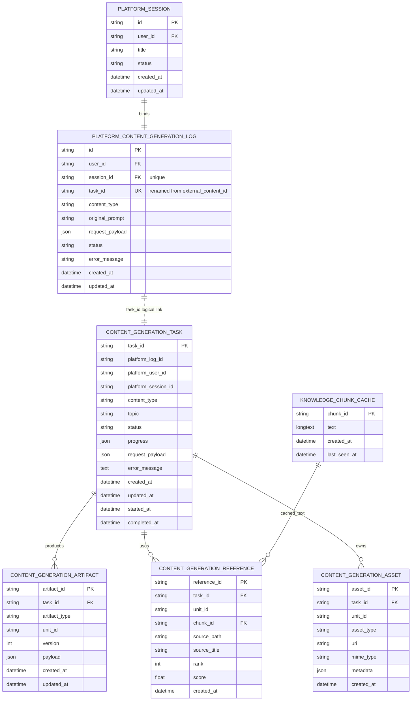

# 内容生成 Agent 数据库表结构重建与迁移指导文档

> 目标：按最终 Mermaid ER 图重建内容生成 Agent 的数据库结构，删除 event/metric 表，不引入 run_log 表，并增加知识文本缓存表，解决 reference 重复存储原文的问题。

---

## 1. 迁移目标

本次迁移的核心目标是把内容生成 Agent 数据库从“workflow 全量状态快照表”调整为“任务索引 + 产物存储 + 引用追溯 + 资产记录 + 知识文本缓存”的结构。

最终保留与新增表如下：

| 表名                           | 处理       | 职责                                                              |
| ------------------------------ | ---------- | ----------------------------------------------------------------- |
| `content_generation_task`      | 保留并瘦身 | 记录生成任务生命周期、平台关联、请求快照与错误摘要                |
| `content_generation_artifact`  | 保留并瘦身 | 记录生成产物，如 outline、content_spec、final_render、unit_render |
| `content_generation_reference` | 保留并重构 | 记录任务/单元引用了哪些知识片段，不再保存原文                     |
| `content_generation_asset`     | 保留并瘦身 | 记录图片、音频、HTML、PPTX、PDF 等生成资产                        |
| `knowledge_chunk_cache`        | 新增       | 以 `chunk_id` 缓存知识文本，避免 reference 重复存储大段原文       |

删除或停止使用：

| 表名                         | 处理     |
| ---------------------------- | -------- |
| `content_generation_event`   | 删除     |
| `content_generation_metric`  | 删除     |
| `content_generation_run_log` | 暂不引入 |

---

## 2. 最终 ER 图



说明：

- `PLATFORM_CONTENT_GENERATION_LOG.task_id` 与 `CONTENT_GENERATION_TASK.task_id` 是跨服务逻辑关联，不建立数据库级外键。
- Agent 侧真实数据库只包含 `CONTENT_GENERATION_TASK / ARTIFACT / REFERENCE / ASSET / KNOWLEDGE_CHUNK_CACHE`。
- 平台侧表仅在图中表示关联关系，不属于本仓库迁移范围。

---

## 3. 新表结构设计

### 3.1 `content_generation_task`

任务主表只保留生命周期、平台关联、请求快照和错误摘要。

| 字段                  | 类型           | 约束                  | 说明                             |
| --------------------- | -------------- | --------------------- | -------------------------------- |
| `task_id`             | `VARCHAR(64)`  | PK                    | 任务唯一 ID                      |
| `platform_log_id`     | `VARCHAR(64)`  | index, nullable       | 平台 `content_generation_log.id` |
| `platform_user_id`    | `VARCHAR(64)`  | index, nullable       | 平台用户 ID                      |
| `platform_session_id` | `VARCHAR(64)`  | index, nullable       | 平台 session ID                  |
| `content_type`        | `VARCHAR(32)`  | not null, index       | 内容类型，如 `interactive_html`  |
| `topic`               | `VARCHAR(255)` | nullable              | 用户学习主题                     |
| `status`              | `VARCHAR(32)`  | not null, index       | 任务状态                         |
| `progress`            | `JSON`         | nullable/default `{}` | 当前进度、节点、阶段说明         |
| `request_payload`     | `JSON`         | nullable/default `{}` | 原始请求快照                     |
| `error_message`       | `TEXT`         | nullable              | 错误摘要                         |
| `created_at`          | `DATETIME`     | not null              | 创建时间                         |
| `updated_at`          | `DATETIME`     | not null              | 更新时间                         |
| `started_at`          | `DATETIME`     | nullable              | 开始时间                         |
| `completed_at`        | `DATETIME`     | nullable              | 完成时间                         |

从旧 task 表中删除或不再使用：

```text
id
generation_options
preview_url
current_node
outline
content_spec
render_model
partial_render_model
unit_results
render_units
stream_events
elements
logs
asset_ids
export_files
errors
```

这些内容要么可以从 `progress` 派生，要么应进入 `content_generation_artifact / content_generation_asset`，不要继续放在 task 主表。

---

### 3.2 `content_generation_artifact`

Artifact 表负责保存所有生成产物。

| 字段            | 类型           | 约束           | 说明                    |
| --------------- | -------------- | -------------- | ----------------------- |
| `artifact_id`   | `VARCHAR(64)`  | PK             | 产物 ID                 |
| `task_id`       | `VARCHAR(64)`  | FK/index       | 所属任务                |
| `artifact_type` | `VARCHAR(32)`  | index          | 产物类型                |
| `unit_id`       | `VARCHAR(128)` | nullable/index | 单元 ID；任务级产物为空 |
| `version`       | `INT`          | default `1`    | 版本号                  |
| `payload`       | `JSON`         | not null       | 产物主体                |
| `created_at`    | `DATETIME`     | not null       | 创建时间                |
| `updated_at`    | `DATETIME`     | not null       | 更新时间                |

推荐 `artifact_type`：

| 类型              | 说明                       |
| ----------------- | -------------------------- |
| `outline`         | 全局大纲                   |
| `content_spec`    | 内容规格                   |
| `partial_render`  | 过程预览                   |
| `final_render`    | 最终预览/最终 render model |
| `unit_spec`       | 单元规格                   |
| `unit_render`     | 单元渲染结果               |
| `export_manifest` | 导出结果清单               |

对于 `interactive_html`，最终预览建议保存在：

```text
artifact_type = final_render
payload = {
  "content_type": "interactive_html",
  "render_model": {...}
}
```

这样 `/tasks/{task_id}/preview` 可以直接读取最新 `final_render` artifact 并返回。

---

### 3.3 `knowledge_chunk_cache`

缓存表用于存储知识库返回的 `text`，避免每条 reference 都重复保存大段原文。

| 字段           | 类型          | 约束     | 说明                 |
| -------------- | ------------- | -------- | -------------------- |
| `chunk_id`     | `VARCHAR(64)` | PK       | 由知识文本 hash 生成 |
| `text`         | `LONGTEXT`    | not null | 知识文本原文         |
| `created_at`   | `DATETIME`    | not null | 首次缓存时间         |
| `last_seen_at` | `DATETIME`    | not null | 最近一次被引用时间   |

`chunk_id` 建议生成方式：

```python
chunk_id = sha256(normalized_text.encode("utf-8")).hexdigest()
```

建议只基于 `text` 生成 hash，而不是 `path + text`。这样相同文本即使来自不同 path，也只缓存一份。来源差异由 `content_generation_reference.source_path/source_title` 表达。

---

### 3.4 `content_generation_reference`

Reference 表只存引用关系与轻量来源信息，不再存原文。

知识库实际返回格式为：

```json
{
  "path": "concepts/端侧多模态效率优化.md",
  "title": "端侧多模态效率优化",
  "text": "..."
}
```

因此表字段应围绕 `path/title/text` 设计，不再保留知识库没有返回、当前业务也用不到的字段。

| 字段           | 类型           | 约束           | 说明                                  |
| -------------- | -------------- | -------------- | ------------------------------------- |
| `reference_id` | `VARCHAR(64)`  | PK             | 引用记录 ID                           |
| `task_id`      | `VARCHAR(64)`  | FK/index       | 所属任务                              |
| `unit_id`      | `VARCHAR(128)` | nullable/index | 所属单元；任务级引用可为空            |
| `chunk_id`     | `VARCHAR(64)`  | FK/index       | 指向 `knowledge_chunk_cache.chunk_id` |
| `source_path`  | `VARCHAR(512)` | not null       | 知识库返回的 `path`                   |
| `source_title` | `VARCHAR(255)` | nullable       | 知识库返回的 `title`                  |
| `rank`         | `INT`          | nullable       | 检索排名                              |
| `score`        | `FLOAT`        | nullable       | 检索分数                              |
| `created_at`   | `DATETIME`     | not null       | 创建时间                              |

建议唯一约束：

```text
UNIQUE(task_id, unit_id, chunk_id, source_path)
```

作用：同一个任务、同一个单元中，同一段文本、同一来源只保留一条引用记录，避免 workflow retry 时重复插入。

删除或不再使用的旧字段：

```text
artifact_id
stage
knowledge_base_id
source_id
retrieval_query
content_excerpt
content_hash
metadata
```

理由：

| 字段                | 删除理由                                                                |
| ------------------- | ----------------------------------------------------------------------- |
| `artifact_id`       | 当前引用主要按 `task_id + unit_id` 查询，直接关联 artifact 会增加复杂度 |
| `stage`             | 第一版不分析不同生成阶段的引用来源                                      |
| `knowledge_base_id` | 知识库返回格式没有该字段                                                |
| `source_id`         | 知识库返回格式没有该字段，`source_path` 已足够                          |
| `retrieval_query`   | 第一版不做检索诊断                                                      |
| `content_excerpt`   | 会重复存文本；需要摘要时从缓存文本截断                                  |
| `content_hash`      | 已由 `chunk_id` 承担                                                    |
| `metadata`          | 第一版不保留兜底字段，避免继续膨胀                                      |

---

### 3.5 `content_generation_asset`

资产表只存生成任务关联的外部资源或导出文件。

| 字段         | 类型           | 约束           | 说明                              |
| ------------ | -------------- | -------------- | --------------------------------- |
| `asset_id`   | `VARCHAR(64)`  | PK             | 资产 ID                           |
| `task_id`    | `VARCHAR(64)`  | FK/index       | 所属任务                          |
| `unit_id`    | `VARCHAR(128)` | nullable/index | 所属单元                          |
| `asset_type` | `VARCHAR(32)`  | not null/index | `image/audio/html/pdf/pptx/other` |
| `uri`        | `VARCHAR(512)` | not null       | 访问地址或存储路径                |
| `mime_type`  | `VARCHAR(128)` | nullable       | 文件类型                          |
| `metadata`   | `JSON`         | nullable       | 资产附加信息                      |
| `created_at` | `DATETIME`     | not null       | 创建时间                          |

删除或不再使用：

```text
provider
model
status
storage_key
updated_at
```

第一版如果不做资产异步生成状态管理，就不需要 `status`。如果后续接对象存储，再考虑恢复 `storage_key`。

---

## 4. 推荐 SQL DDL

以下 SQL 主要用于确认结构。实际实现仍建议优先改 SQLModel 模型，再通过迁移脚本执行。

```sql
CREATE TABLE content_generation_task (
    task_id VARCHAR(64) PRIMARY KEY,
    platform_log_id VARCHAR(64),
    platform_user_id VARCHAR(64),
    platform_session_id VARCHAR(64),
    content_type VARCHAR(32) NOT NULL,
    topic VARCHAR(255),
    status VARCHAR(32) NOT NULL,
    progress JSON,
    request_payload JSON,
    error_message TEXT,
    created_at DATETIME NOT NULL,
    updated_at DATETIME NOT NULL,
    started_at DATETIME,
    completed_at DATETIME,

    INDEX idx_task_platform_log_id (platform_log_id),
    INDEX idx_task_platform_user_id (platform_user_id),
    INDEX idx_task_platform_session_id (platform_session_id),
    INDEX idx_task_content_type (content_type),
    INDEX idx_task_status (status)
);
```

```sql
CREATE TABLE content_generation_artifact (
    artifact_id VARCHAR(64) PRIMARY KEY,
    task_id VARCHAR(64) NOT NULL,
    artifact_type VARCHAR(32) NOT NULL,
    unit_id VARCHAR(128),
    version INT NOT NULL DEFAULT 1,
    payload JSON NOT NULL,
    created_at DATETIME NOT NULL,
    updated_at DATETIME NOT NULL,

    INDEX idx_artifact_task_id (task_id),
    INDEX idx_artifact_task_type (task_id, artifact_type),
    INDEX idx_artifact_task_unit (task_id, unit_id),
    INDEX idx_artifact_task_type_unit (task_id, artifact_type, unit_id),

    FOREIGN KEY (task_id) REFERENCES content_generation_task(task_id)
);
```

```sql
CREATE TABLE knowledge_chunk_cache (
    chunk_id VARCHAR(64) PRIMARY KEY,
    text LONGTEXT NOT NULL,
    created_at DATETIME NOT NULL,
    last_seen_at DATETIME NOT NULL
);
```

```sql
CREATE TABLE content_generation_reference (
    reference_id VARCHAR(64) PRIMARY KEY,
    task_id VARCHAR(64) NOT NULL,
    unit_id VARCHAR(128),
    chunk_id VARCHAR(64) NOT NULL,
    source_path VARCHAR(512) NOT NULL,
    source_title VARCHAR(255),
    rank INT,
    score FLOAT,
    created_at DATETIME NOT NULL,

    INDEX idx_reference_task_id (task_id),
    INDEX idx_reference_task_unit (task_id, unit_id),
    INDEX idx_reference_chunk_id (chunk_id),
    UNIQUE KEY uq_reference_dedup (task_id, unit_id, chunk_id, source_path),

    FOREIGN KEY (task_id) REFERENCES content_generation_task(task_id),
    FOREIGN KEY (chunk_id) REFERENCES knowledge_chunk_cache(chunk_id)
);
```

```sql
CREATE TABLE content_generation_asset (
    asset_id VARCHAR(64) PRIMARY KEY,
    task_id VARCHAR(64) NOT NULL,
    unit_id VARCHAR(128),
    asset_type VARCHAR(32) NOT NULL,
    uri VARCHAR(512) NOT NULL,
    mime_type VARCHAR(128),
    metadata JSON,
    created_at DATETIME NOT NULL,

    INDEX idx_asset_task_id (task_id),
    INDEX idx_asset_task_unit (task_id, unit_id),
    INDEX idx_asset_type (asset_type),

    FOREIGN KEY (task_id) REFERENCES content_generation_task(task_id)
);
```

---

## 5. SQLModel 模型改造建议

建议在 `backend/app/models/` 下保留或新增这些模型文件：

```text
backend/app/models/content_generation_task.py
backend/app/models/content_generation_artifact.py
backend/app/models/content_generation_reference.py
backend/app/models/content_generation_asset.py
backend/app/models/knowledge_chunk_cache.py
```

删除或停止导入：

```text
backend/app/models/content_generation_event.py
backend/app/models/content_generation_metric.py
```

`backend/app/models/__init__.py` 只导入新的五个模型。

### 5.1 `KnowledgeChunkCache` 示例

```python
from datetime import datetime, timezone
from sqlmodel import Field, SQLModel
from sqlalchemy import Column
from sqlalchemy.dialects.mysql import LONGTEXT


def utc_now() -> datetime:
    return datetime.now(timezone.utc)


class KnowledgeChunkCache(SQLModel, table=True):
    __tablename__ = "knowledge_chunk_cache"

    chunk_id: str = Field(primary_key=True, max_length=64)
    text: str = Field(sa_column=Column(LONGTEXT, nullable=False))
    created_at: datetime = Field(default_factory=utc_now, nullable=False)
    last_seen_at: datetime = Field(default_factory=utc_now, nullable=False)
```

### 5.2 `ContentGenerationReference` 示例

```python
from datetime import datetime, timezone
from typing import Optional
from sqlmodel import Field, SQLModel
from sqlalchemy import UniqueConstraint


def utc_now() -> datetime:
    return datetime.now(timezone.utc)


class ContentGenerationReference(SQLModel, table=True):
    __tablename__ = "content_generation_reference"
    __table_args__ = (
        UniqueConstraint(
            "task_id",
            "unit_id",
            "chunk_id",
            "source_path",
            name="uq_reference_dedup",
        ),
    )

    reference_id: str = Field(primary_key=True, max_length=64)
    task_id: str = Field(foreign_key="content_generation_task.task_id", index=True, max_length=64)
    unit_id: Optional[str] = Field(default=None, index=True, max_length=128)
    chunk_id: str = Field(foreign_key="knowledge_chunk_cache.chunk_id", index=True, max_length=64)
    source_path: str = Field(max_length=512)
    source_title: Optional[str] = Field(default=None, max_length=255)
    rank: Optional[int] = None
    score: Optional[float] = None
    created_at: datetime = Field(default_factory=utc_now, nullable=False)
```

### 5.3 JSON 字段建议

SQLModel 中 JSON 字段建议继续用 SQLAlchemy Column：

```python
from sqlalchemy import Column, JSON
from sqlmodel import Field

progress: dict = Field(default_factory=dict, sa_column=Column(JSON))
payload: dict = Field(sa_column=Column(JSON, nullable=False))
metadata: dict | None = Field(default=None, sa_column=Column(JSON))
```

如果需要兼容 SQLite，本地测试可以继续使用 JSON Column；MySQL 会落成 JSON 类型。

---

## 6. 知识查询结果写入事务逻辑

知识库返回只有：

```json
{
  "path": "concepts/端侧多模态效率优化.md",
  "title": "端侧多模态效率优化",
  "text": "..."
}
```

因此保存 reference 时必须先写缓存，再写引用关系。

### 6.1 chunk_id 生成

```python
import hashlib


def normalize_knowledge_text(text: str) -> str:
    return text.strip().replace("\r\n", "\n")


def make_chunk_id(text: str) -> str:
    normalized = normalize_knowledge_text(text)
    return hashlib.sha256(normalized.encode("utf-8")).hexdigest()
```

注意：

- `chunk_id` 基于 `text` 生成，不基于 `path/title`。
- `source_path/source_title` 存在 reference 表里，用于区分来源。
- 如果 `text` 为空，应跳过该条引用或写入错误日志，不应生成空文本缓存。

### 6.2 单条知识引用保存流程

```text
knowledge item
  ↓
校验 path/title/text
  ↓
chunk_id = sha256(normalized_text)
  ↓
UPSERT knowledge_chunk_cache
  ↓
INSERT/UPSERT content_generation_reference
```

伪代码：

```python
from datetime import datetime, timezone
from sqlalchemy.dialects.mysql import insert as mysql_insert


def utc_now():
    return datetime.now(timezone.utc)


def save_knowledge_reference(
    session,
    *,
    task_id: str,
    unit_id: str | None,
    item: dict,
    rank: int | None = None,
    score: float | None = None,
):
    text = (item.get("text") or "").strip()
    if not text:
        return None

    source_path = item.get("path") or "unknown"
    source_title = item.get("title")
    chunk_id = make_chunk_id(text)
    now = utc_now()

    # 1. upsert cache
    stmt = mysql_insert(KnowledgeChunkCache).values(
        chunk_id=chunk_id,
        text=normalize_knowledge_text(text),
        created_at=now,
        last_seen_at=now,
    )
    stmt = stmt.on_duplicate_key_update(
        last_seen_at=now,
    )
    session.exec(stmt)

    # 2. insert reference; duplicate means retry/repeated retrieval, skip or update rank/score
    reference_id = make_reference_id(task_id, unit_id, chunk_id, source_path)
    ref_stmt = mysql_insert(ContentGenerationReference).values(
        reference_id=reference_id,
        task_id=task_id,
        unit_id=unit_id,
        chunk_id=chunk_id,
        source_path=source_path,
        source_title=source_title,
        rank=rank,
        score=score,
        created_at=now,
    )
    ref_stmt = ref_stmt.on_duplicate_key_update(
        rank=rank,
        score=score,
    )
    session.exec(ref_stmt)

    return chunk_id
```

如果不想绑定 MySQL 方言，可以用更通用的写法：

```python
cache = session.get(KnowledgeChunkCache, chunk_id)
if cache is None:
    session.add(KnowledgeChunkCache(...))
else:
    cache.last_seen_at = now

existing = find_reference_by_unique_key(...)
if existing is None:
    session.add(ContentGenerationReference(...))
else:
    existing.rank = rank
    existing.score = score
```

### 6.3 批量保存事务

一次检索通常返回多条知识结果，建议在同一个数据库事务里完成。

```python
def save_retrieved_references(
    session,
    *,
    task_id: str,
    unit_id: str | None,
    retrieved_items: list[dict],
):
    with session.begin():
        for idx, item in enumerate(retrieved_items, start=1):
            save_knowledge_reference(
                session,
                task_id=task_id,
                unit_id=unit_id,
                item=item,
                rank=idx,
                score=item.get("score"),
            )
```

如果当前代码的 session 生命周期已经在外部管理，就不要嵌套 `session.begin()`，改为由上层统一提交。

### 6.4 与 artifact 保存的事务边界

建议采用两个事务边界：

#### 事务 A：任务状态与检索引用

用于保存：

```text
task.status / progress
knowledge_chunk_cache
content_generation_reference
```

#### 事务 B：生成产物

用于保存：

```text
content_generation_artifact
content_generation_asset
```

原因：检索引用保存失败时，可以让任务失败并记录错误；但生成产物保存失败时，也应该明确失败，不要出现“任务 completed 但 final_render 未入库”的状态。

对于最终完成状态，必须保证：

```text
final_render artifact 保存成功
  ↓
task.status = completed
```

不要先把 task 标记为 completed，再保存 final_render。

---

## 7. 代码改造点

### 7.1 模型导入

修改：

```text
backend/app/models/__init__.py
```

只导入：

```python
from .content_generation_task import ContentGenerationTask
from .content_generation_artifact import ContentGenerationArtifact
from .content_generation_reference import ContentGenerationReference
from .content_generation_asset import ContentGenerationAsset
from .knowledge_chunk_cache import KnowledgeChunkCache
```

删除：

```python
ContentGenerationEvent
ContentGenerationMetric
```

---

### 7.2 持久化服务 `save_state()`

当前 `save_state()` 中如果存在以下逻辑，需要删除或重写：

```text
写 task.outline
写 task.content_spec
写 task.render_model
写 task.partial_render_model
写 task.unit_results
写 task.render_units
写 task.stream_events
写 task.logs
写 task.asset_ids
写 task.export_files
写 content_generation_event
写 content_generation_metric
```

新的 `save_state()` 建议拆成以下内部函数：

```python
upsert_task_lifecycle(state)
upsert_artifacts(state)
upsert_references(state)
upsert_assets(state)
```

其中：

| 函数                    | 职责                                                |
| ----------------------- | --------------------------------------------------- |
| `upsert_task_lifecycle` | 只更新任务状态、progress、时间、错误                |
| `upsert_artifacts`      | 写 outline/content_spec/final_render/unit_render 等 |
| `upsert_references`     | 调用知识缓存事务逻辑                                |
| `upsert_assets`         | 写资产记录                                          |

### 7.3 `/preview` 接口

`GET /tasks/{task_id}/preview` 应改为：

```text
查 content_generation_artifact
where task_id = :task_id
  and artifact_type = 'final_render'
order by version desc, updated_at desc
limit 1
```

如果没有 `final_render`：

- 任务未完成：返回 404 或 409，提示 preview not ready；
- 任务失败：返回失败信息；
- 不要再 fallback 到 task.render_model，因为新 task 表已经不存 render_model。

返回格式保持不变：

```json
{
  "content_type": "interactive_html",
  "render_model": {...}
}
```

### 7.4 `/preview/partial` 接口

同理，读取：

```text
artifact_type = partial_render
```

如果不存在，返回空或 404。

### 7.5 `/references` 接口

建议返回时 join 缓存表，组装成更贴近知识库原始格式的结构。

查询：

```sql
SELECT
    r.reference_id,
    r.task_id,
    r.unit_id,
    r.source_path,
    r.source_title,
    r.rank,
    r.score,
    c.chunk_id,
    c.text
FROM content_generation_reference r
JOIN knowledge_chunk_cache c ON r.chunk_id = c.chunk_id
WHERE r.task_id = :task_id
ORDER BY r.unit_id, r.rank, r.created_at;
```

返回建议：

```json
{
  "task_id": "...",
  "references": [
    {
      "unit_id": "section_1",
      "chunk_id": "...",
      "path": "concepts/端侧多模态效率优化.md",
      "title": "端侧多模态效率优化",
      "text": "...",
      "rank": 1,
      "score": 0.82
    }
  ]
}
```

---

## 8. 迁移策略

### 8.1 开发环境推荐：重建数据库

如果当前数据库没有必须保留的历史数据，最简单可靠的方式是：

```text
1. 停止 content-generator-agent 容器
2. 备份数据库
3. 删除旧表
4. 更新 SQLModel 模型
5. 启动服务，执行 create_all 或迁移脚本
6. 重新跑一条 interactive_html 生成任务验证
```

旧表删除顺序建议：

```text
content_generation_metric
content_generation_event
content_generation_reference
content_generation_asset
content_generation_artifact
content_generation_task
```

然后重建：

```text
content_generation_task
content_generation_artifact
knowledge_chunk_cache
content_generation_reference
content_generation_asset
```

### 8.2 有历史数据时：迁移脚本

如果需要保留历史数据，建议不要直接 ALTER 大表，而是采用新表迁移：

```text
1. 创建新表：xxx_new
2. 从旧表抽取需要字段写入新表
3. 校验数据量和关键 task_id
4. 旧表 rename 为 xxx_backup
5. 新表 rename 为正式表
6. 验证 API
7. 删除 backup
```

#### task 迁移

旧 task 表迁移到新 task 表时，只保留：

```text
task_id
platform_log_id
platform_user_id
platform_session_id
content_type
topic
status
progress
request_payload
error_summary/error_message
created_at
updated_at
started_at
completed_at
```

如果旧字段叫 `error_summary`，迁移到新字段：

```text
error_message = error_summary
```

#### artifact 迁移

旧 artifact 表如果已有：

```text
id
task_id
artifact_type
unit_id
unit_order
version
status
payload
source_node
created_at
updated_at
```

新表只保留：

```text
artifact_id = id
task_id
artifact_type
unit_id
version
payload
created_at
updated_at
```

如果旧 task 表里有 `render_model` 但旧 artifact 没有 `final_render`，可以补一条：

```text
artifact_type = final_render
payload = {"content_type": task.content_type, "render_model": task.render_model}
```

#### reference 迁移

旧 reference 表如果有 `content_excerpt`，可以临时把它作为缓存文本：

```text
text = content_excerpt
chunk_id = sha256(normalized_text)
```

但要注意：旧 `content_excerpt` 未必是完整知识文本，可能只是片段。因此历史 reference 迁移可能是有损的。若当前没有重要历史数据，建议直接重建，不迁移旧 reference。

字段映射建议：

| 新字段         | 旧字段来源                                                      |
| -------------- | --------------------------------------------------------------- |
| `reference_id` | 旧 `id` 或重新生成                                              |
| `task_id`      | 旧 `task_id`                                                    |
| `unit_id`      | 旧 `unit_id`                                                    |
| `chunk_id`     | 由旧 `content_excerpt` 或旧 `chunk_id` 生成/映射                |
| `source_path`  | 优先旧 `metadata.path`，否则旧 `source_id`，再否则旧 `chunk_id` |
| `source_title` | 旧 `source_title`                                               |
| `rank`         | 无则为空                                                        |
| `score`        | 旧 `score`                                                      |
| `created_at`   | 旧 `created_at`                                                 |

#### asset 迁移

字段映射：

| 新字段       | 旧字段                                                    |
| ------------ | --------------------------------------------------------- |
| `asset_id`   | 旧 `id`                                                   |
| `task_id`    | 旧 `task_id`                                              |
| `unit_id`    | 旧 `unit_id`                                              |
| `asset_type` | 旧 `asset_type`                                           |
| `uri`        | 旧 `asset_url`                                            |
| `mime_type`  | 旧 `mime_type`                                            |
| `metadata`   | 旧 `metadata`，可合并 `provider/model/storage_key/status` |
| `created_at` | 旧 `created_at`                                           |

---

## 9. 迁移后关键查询

### 9.1 查询任务状态

```sql
SELECT *
FROM content_generation_task
WHERE task_id = :task_id;
```

### 9.2 查询最终 preview

```sql
SELECT payload
FROM content_generation_artifact
WHERE task_id = :task_id
  AND artifact_type = 'final_render'
ORDER BY version DESC, updated_at DESC
LIMIT 1;
```

### 9.3 查询任务引用文本

```sql
SELECT
    r.unit_id,
    r.source_path AS path,
    r.source_title AS title,
    c.text,
    r.rank,
    r.score
FROM content_generation_reference r
JOIN knowledge_chunk_cache c ON r.chunk_id = c.chunk_id
WHERE r.task_id = :task_id
ORDER BY r.unit_id, r.rank, r.created_at;
```

### 9.4 查询某个单元引用文本

```sql
SELECT
    r.source_path AS path,
    r.source_title AS title,
    c.text,
    r.rank,
    r.score
FROM content_generation_reference r
JOIN knowledge_chunk_cache c ON r.chunk_id = c.chunk_id
WHERE r.task_id = :task_id
  AND r.unit_id = :unit_id
ORDER BY r.rank, r.created_at;
```

### 9.5 查询任务资产

```sql
SELECT *
FROM content_generation_asset
WHERE task_id = :task_id
ORDER BY created_at;
```

---

## 10. API 行为调整

### 10.1 创建任务

`POST /api/content-generation/tasks` 行为保持：

```text
创建 content_generation_task
status = pending/running
保存 request_payload
保存 platform_log_id/platform_user_id/platform_session_id
```

创建任务时不再初始化大 JSON 字段。

### 10.2 任务进度

`GET /api/content-generation/tasks/{task_id}` 返回 task 主表信息即可。

建议响应里继续保留：

```json
{
  "task_id": "...",
  "content_type": "interactive_html",
  "status": "running",
  "progress": {...},
  "error_message": null,
  "created_at": "...",
  "updated_at": "..."
}
```

### 10.3 最终 preview

`GET /api/content-generation/tasks/{task_id}/preview` 从 artifact 表读取 `final_render`。

### 10.4 partial preview

`GET /api/content-generation/tasks/{task_id}/preview/partial` 从 artifact 表读取 `partial_render`。

### 10.5 references

`GET /api/content-generation/tasks/{task_id}/references` 从 reference + cache join 返回。

可选参数：

```text
include_text=true/false
unit_id=xxx
```

---

## 11. 验证清单

迁移完成后，至少验证以下场景。

### 11.1 数据库结构验证

- [ ] `content_generation_task` 不再包含 `render_model / outline / unit_results / logs / errors` 等大字段。
- [ ] `content_generation_event` 表不存在或不再被导入/写入。
- [ ] `content_generation_metric` 表不存在或不再被导入/写入。
- [ ] `knowledge_chunk_cache` 表存在。
- [ ] `content_generation_reference.chunk_id` 能正确关联缓存表。
- [ ] `content_generation_reference` 不再保存原文。

### 11.2 生成任务验证

- [ ] 创建 interactive_html 任务成功。
- [ ] `content_generation_task` 只写入任务生命周期字段。
- [ ] 生成过程中可以更新 `progress`。
- [ ] 生成完成后写入 `final_render` artifact。
- [ ] `/preview` 能从 `final_render` artifact 返回 render model。

### 11.3 知识引用验证

- [ ] 同一段知识文本多次被检索，只在 `knowledge_chunk_cache` 存一份。
- [ ] 多条 reference 可以指向同一个 `chunk_id`。
- [ ] reference 能保留 `source_path/source_title`。
- [ ] `/references` 能 join 出 `path/title/text`。
- [ ] workflow retry 不会重复插入同一条 reference。

### 11.4 前端兼容验证

- [ ] 前端仍能轮询任务状态。
- [ ] 前端仍能获取 partial preview。
- [ ] 前端仍能获取 final preview。
- [ ] interactive_html renderer 能拿到 `render_model.render_type = interactive_html_page`。
- [ ] `sections[].html_fragment/css_fragment` 能正常渲染。

---

## 12. 建议实施顺序

建议按以下顺序推进：

```text
1. 修改 SQLModel 模型
2. 修改 models/__init__.py
3. 新增 knowledge_chunk_cache 模型
4. 修改 save_state / persistence service
5. 修改 reference 保存逻辑：cache first, reference second
6. 修改 /preview 读取逻辑：只读 final_render artifact
7. 修改 /references 读取逻辑：join cache
8. 删除 event/metric 写入代码
9. 开发环境重建数据库并跑通 interactive_html
10. 如有历史数据，再补迁移脚本
```

---

## 13. 最终判断

这版数据库结构的核心收益是：

1. `task` 表回到任务索引职责，不再承载庞大 workflow 状态。
2. `artifact` 统一保存生成产物，`final_render` 成为 preview 的唯一来源。
3. `reference` 不再重复保存知识原文，存储压力显著降低。
4. `knowledge_chunk_cache` 通过 `chunk_id = sha256(text)` 实现跨任务文本去重。
5. `asset` 保持轻量，后续可按对象存储需求扩展。
6. event/metric 暂时删除，降低首版复杂度。

第一版迁移应优先保证 interactive_html 主链路：

```text
create task
  → retrieve knowledge
  → cache knowledge text
  → save references
  → save final_render artifact
  → preview reads final_render
```

只要这条链路稳定，后续再补导出、资产存储、引用展示和助教上下文查询都会比较顺。
