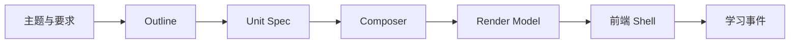

# 互动讲义

互动讲义按“教学大纲 → 单元规格 → HTML/CSS → 前端运行时”生成。在线工作台按章节展示讲解和练习；导出时生成附带作答记录的单文件静态讲义。

## 流水线

1. **Outline（大纲）**：章节数量至少为 1，不能超过 `generation_options.max_section_count`，默认上限为 8。大纲单元使用 `id / title / goal / core_message / key_points / retrieval_queries / source_chunk_ids` 等字段；教学块、互动题目和概念由单元规格进一步设计。
2. **Unit Spec**：逐章设计 `teaching_flow`、`interaction_specs`、概念与引用。此阶段只描述“教什么、怎么互动”，不写 HTML。
3. **Composer**：把单元规格渲染为受限 HTML 片段与作用域 CSS。前端负责外壳、导航、样式容器与交互运行时。
4. **Render Model**：`InteractiveHtmlRenderModel` 包含章节 HTML、块清单、交互清单、导航与运行时配置。

## 教学块

`InteractiveHtmlTeachingBlock.block_type` 支持：

`intro`、`concept_explanation`、`case_compare`、`animated_flow`、`context_inspector`、`stepper`、`socratic_chat`、`scenario`、`scenario_discussion`、`single_choice`、`multiple_choice`、`short_answer`、`drag_match`、`sequence`、`reflection`、`summary`。

每个块都有 `block_id`、`title`、`teaching_role`、`content_goal` 与 `must_cover`，渲染后进入 `block_manifest`。

## 互动

`InteractiveHtmlInteractionSpec` 支持四类互动。选择题在浏览器中判定答案；简答和讨论保存文本与参考要点，当前主运行时不提供自动评分：

| 类型 | 事件 | 说明 |
|---|---|---|
| `single_choice` | `single_choice_answered` | 单选，提交 `selected_option_ids` 与 `is_correct` |
| `multiple_choice` | `multiple_choice_answered` | 多选，提交选项与正确选项 |
| `short_answer` | `short_answer_submitted` | 短答，提交 `answer_text` |
| `scenario_discussion` | `scenario_discussion_submitted` | 情境讨论，提交文本 |

另有 `hint_requested`、`confused_clicked` 等求助事件。每个互动都可声明 `target_concepts`，这是学习摘要把错题映射回概念的桥梁。

前端运行时负责选项高亮、反馈文案、步骤切换、配对与排序；事件通过 `POST /api/interactive-lessons/{lesson_id}/sessions/{session_id}/events` 提交。

## 前端外壳

- 左侧章节导航与完成状态，右侧当前章节卡片。
- 章节 HTML 经 DOMPurify 白名单清洗；禁止脚本、内联事件与外部资源。
- 会话存于 `localStorage`，键为 `interactive-html-session:{lesson_id}`；重新打开同一讲义会复用并校验会话。
- 导出互动讲义 HTML 时会附带 `session_id`，生成带答题记录的离线讲义。

## 离线讲义

`InteractiveHtmlStaticHandoutRenderer` 保留在线讲义的外壳与章节 HTML，移除按钮、输入框和运行时动作，并在每章追加：

- 学生回答；
- 对错判断（正确 / 需要复习 / 已记录）；
- 参考答案；
- 引用来源。

导出入口：`POST /api/content-generation/tasks/{task_id}/export`，`export_type="html"`，`export_options.session_id` 必填。

## 相关文件

| 能力 | 文件 |
|---|---|
| 大纲/单元/渲染 schema | `backend/app/schemas/specs/interactive_html.py` |
| 渲染契约 | `backend/app/schemas/render/interactive_html.py` |
| Composer | `backend/app/renderers/interactive_html_composer.py` |
| 离线讲义 | `backend/app/renderers/interactive_html_handout.py` |
| 前端运行时 | `frontend/src/components/renderers/InteractiveHtmlRenderer/` |
| 学习服务 | `backend/app/services/learning_service.py` |
