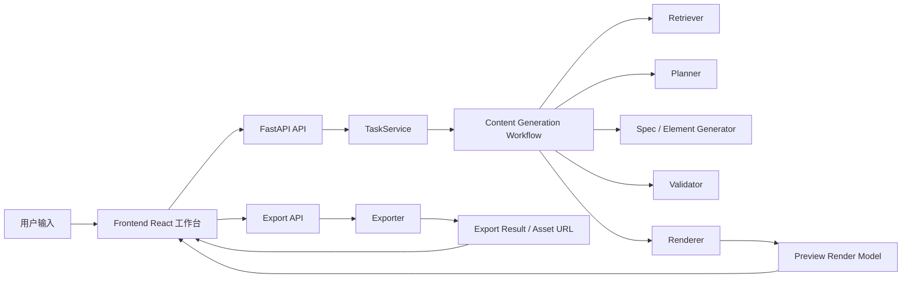

# 内容生成 Agent 项目介绍

## 1. 项目定位

本项目是“内容生成 Agent”的可启动工程骨架，用于承载后续多模态内容生成能力。系统目标是基于系统 Prompt、用户 Prompt 与外部知识库内容，生成可预览、可渲染、可导出、可扩展的结构化内容资源。

当前工程已实现项目结构、统一 schema、API 契约、工作流节点边界、前端预览入口、Local 资源存储与导出资源访问链路，并补充了可配置的 LLM、图片生成与 RAG 检索 service。默认运行仍使用 stub workflow，避免开发和测试时误调用付费 API；真实 provider service 已封装在后端服务层，后续在 workflow 节点中接入并保持整体架构稳定。

项目采用 monorepo 结构：

```text
content-generator-agent/
  backend/
    app/
  storage/
    files/
    manifest.json
  frontend/
    src/
  docs/
```

核心生成流程统一为：

```text
content_request
  -> outline
  -> content_spec
  -> elements
  -> renderer
```

该流程是后续新增内容类型和元素类型时必须遵守的生成主线。导出由前端导出动作触发，后端基于已生成的渲染快照和资源执行目标格式导出。

## 2. 总体架构

系统分为后端生成编排层、统一 schema 层、前端预览层和文档/测试支撑层。



后端负责生成任务、工作流编排、schema 校验、渲染模型和按需导出；前端负责提交任务、展示任务状态、展示讲义或 Slide 预览，以及触发导出。

当前内容生成 workflow 仍为同步 stub，创建任务后立即返回 `completed` 并提供预览入口。生成过程中产生的图片占位资源会写入本地 `storage/` 目录；前端触发导出后，PDF 导出文件、Slide JSON 导出文件和资源包会写入本地 `storage/` 目录，并通过 `/api/assets/{asset_id}` 与 `/api/assets/{asset_id}/download` 暴露元数据和下载入口。真实 LLM、图片和检索 provider 已在 service 层实现，后续接入真实异步任务队列和真实生成节点时，应保持 API 响应结构不变，只调整 `TaskService` 与 workflow 执行方式。

## 3. 后端模块说明

### 3.1 API 层

位置：`backend/app/api/`

当前文件：

- `content_generation.py`
- `assets.py`

职责：

- 暴露内容生成任务 API。
- 暴露资源访问 API。
- 将 HTTP 请求转换为 Pydantic schema。
- 调用 `TaskService` 执行任务创建、查询、预览和导出。

当前接口：

```text
POST /api/content-generation/tasks
GET  /api/content-generation/tasks/{task_id}
GET  /api/content-generation/tasks/{task_id}/preview
POST /api/content-generation/tasks/{task_id}/export
GET  /api/assets/{asset_id}
GET  /api/assets/{asset_id}/download
```

后续开发预留点：

- 在 `content_generation.py` 中增加任务取消、重试、重新生成、局部章节再生成等 API。
- 在 `assets.py` 中基于当前 Local 资源接口扩展真实对象存储、鉴权和临时签名 URL。
- 在 API 层增加错误码映射和统一异常响应格式。

### 3.2 Core 层

位置：`backend/app/core/`

当前文件：

- `config.py`
- `exceptions.py`
- `logging.py`
- `task.py`

职责：

- 管理应用配置。
- 定义统一异常基类。
- 提供日志入口。
- 定义任务状态枚举。
- 提供 Local 资源存储配置，例如 `storage_root` 和 `/api/assets` 公开访问前缀。
- 统一管理文本、图片、embedding provider 与模型配置。

后续开发预留点：

- 在 `config.py` 中继续增加 OSS/S3、任务队列等配置。
- 在 `exceptions.py` 中扩展业务异常，例如 schema 校验失败、LLM 调用失败、导出失败、资源不存在。
- 在 `logging.py` 中接入结构化日志、trace id、request id 和任务级日志。
- 在 `task.py` 中扩展内容生成阶段状态，例如 `retrieving`、`planning`、`generating`、`rendering`。

关键配置从根目录 `.env` 读取，变量前缀为 `CONTENT_GENERATOR_`。默认值包括：

- `PROVIDER_MODE=stub`：默认不调用真实外部 API。
- `TEXT_PROVIDER=bailian`、`TEXT_MODEL=qwen3.5-flash`。
- `IMAGE_PROVIDER=apimart`、`IMAGE_MODEL=gpt-image-2`、`IMAGE_RESOLUTION=1k`。
- `EMBEDDING_PROVIDER=bailian`、`EMBEDDING_MODEL=text-embedding-v3`。
- `QDRANT_PATH=storage/qdrant_data`、`QDRANT_COLLECTION=default`。

### 3.3 Schema 层

位置：`backend/app/schemas/`

当前文件：

- `base.py`
- `request.py`
- `outline.py`
- `specs.py`
- `elements.py`
- `render.py`
- `export.py`
- `assets.py`
- `task.py`
- `state.py`

职责：

- 使用 Pydantic v2 定义统一数据契约。
- 作为当前项目 schema 单一真源。
- 约束 API 请求、任务状态、工作流状态、内容大纲、内容 Spec、多模态元素、渲染模型和导出结果。

核心 schema：

- `ContentGenerationRequest`：内容生成请求。
- `GenerationOptions`：生成配置。
- `Outline`、`OutlineSection`：统一大纲结构。
- `LectureSpec`：讲义内容结构。
- `SlideDeckSpec`：Slide Deck 内容结构。
- `TextElement`、`ImageElement`、`ChartElement`、`MindmapElement`、`TableElement`、`QuizElement`、`Citation`：多模态元素结构。
- `LectureRenderModel`、`SlideRenderModel`：前端可渲染模型。
- `ExportRequest`、`ExportResult`：导出请求与结果。
- `AssetRecord`、`AssetResponse`：本地资源 manifest 记录与 API 返回结构。
- `ContentGenerationState`：工作流状态。

后续开发预留点：

- 新增内容类型时，在 `base.py` 中扩展 `ContentType`，并在 `specs.py` 中新增对应 Spec。
- 新增元素类型时，在 `elements.py` 中新增 Element schema，并更新 `ContentElement` union。
- 新增导出格式时，在 `base.py` 中扩展 `ExportType`，并在 `exporters/` 中新增实现。
- 新增资源类型时，在 `assets.py` 中扩展 `AssetKind`，并在存储、导出和前端下载入口中同步处理。
- 前端类型当前为手写镜像，后续可通过 `backend/scripts/export_json_schema.py` 导出的 JSON Schema 自动生成 TypeScript 类型。

schema 约束约定：

- 所有 Spec 必须包含 `id`、`type`、`version`、`metadata`。
- 所有 Element 必须包含 `id`、`type`、`title`。
- 图片元素必须包含 `prompt`、`asset_url`、`alt_text`。
- 图表元素必须包含图表类型、坐标轴和数据序列。
- 思维导图元素必须包含 Markdown 大纲。

### 3.4 Workflow 层

位置：`backend/app/workflows/`

当前文件：

- `content_generation_graph.py`
- `states.py`
- `routers.py`
- `nodes/`

职责：

- 承载内容生成主流程。
- 保留 LangGraph 风格的节点边界。
- 根据 `content_type` 选择对应 renderer。
- 通过 `ContentGenerationState` 在各节点之间传递数据。

当前 workflow 节点：

```text
retrieve_context
  -> plan_outline
  -> generate_content_spec
  -> generate_elements
  -> validate_content
  -> render_content
```

当前实现是顺序 stub。`nodes/` 目录下的文件目前只是暴露对应节点函数，用于保持未来拆分边界清晰。

后续开发预留点：

- 将 `content_generation_graph.py` 中的顺序执行替换为真正的 LangGraph `StateGraph`。
- 在 `nodes/retriever_node.py` 中接入真实 RAG 检索。
- 在 `nodes/planner_node.py` 中接入大纲规划 LLM prompt。
- 在 `nodes/generator_node.py` 中接入 `LectureSpecGenerator`、`SlideDeckSpecGenerator`。
- 在 `nodes/element_generator_node.py` 中实现文本、图片、图表、思维导图、表格、测验、引用等并行生成。
- 在 `nodes/validator_node.py` 中加入结构校验、引用校验、内容安全校验和质量检查。
- 在 `nodes/renderer_node.py` 中按内容类型选择 renderer。
- 在导出服务中承接更完整的异步导出、重试和错误恢复逻辑。

预期功能：

- 支持任务级错误恢复。
- 支持节点级重试。
- 支持按章节二次检索。
- 支持元素并行生成。
- 支持任务进度回传。
- 支持后续接入 Celery、Arq 或其他任务队列。

### 3.5 Services 层

位置：`backend/app/services/`

当前文件：

- `llm_service.py`
- `rag_service.py`
- `image_generation_service.py`
- `asset_service.py`
- `storage_service.py`
- `citation_service.py`
- `task_service.py`

职责：

- 封装外部能力和业务服务。
- 将具体供应商、存储系统、任务执行方式从 workflow 中隔离。
- 当前已提供 Local 存储、资源元数据查询、文件下载服务、真实 LLM service、真实图片 provider service 和 Qdrant RAG service。默认 workflow 仍使用 stub，真实 service 通过 factory 按配置创建。

模块功能与预留位置：

`llm_service.py`

- 当前：定义 `LLMService` 协议、`StubLLMService` 和 `BailianLLMService`。
- `BailianLLMService` 通过百炼兼容 OpenAI 的 `/chat/completions` 接口生成结构化 JSON，支持超时、重试、token usage 记录、Pydantic schema 校验和一次 schema repair。
- 后续：将 Planner、Generator、Reviewer 节点接入 `get_llm_service()`，并补充任务级 tracing 与模型路由策略。

`rag_service.py`

- 当前：`StubRAGService` 返回知识库占位片段；`QdrantRAGService` 使用 `langchain_qdrant` 读取 `storage/qdrant_data` 下的本地 Qdrant 数据；`BailianEmbeddingService` 负责查询向量。
- 支持单知识库 collection 选择、按阶段和章节 hint 构造查询、结果去重、按分数排序、字符上限控制和来源 metadata 映射。
- 后续：补充知识库入库流程、混合检索、rerank 与章节级二次检索在 workflow 中的实际调用。

`image_generation_service.py`

- 当前：保留确定性的本地 SVG stub；真实图片默认使用 `APIMartImageGenerationService` 调用 APIMart `gpt-image-2`，提交异步任务、轮询完成状态、下载图片并转存到 Local storage。
- 仍保留 `BailianImageGenerationService`，可通过 `IMAGE_PROVIDER=bailian` 切换。
- 图片 metadata 会记录 provider、model、resolution、aspect ratio、prompt、task id、格式和尺寸推断。
- 后续：在 Element Generator 中按 `get_image_generation_service()` 接入真实 provider，并完善图片失败降级策略。

`asset_service.py`

- 当前：读取 Local storage manifest，为图片、PDF、Slide JSON 和资源包返回资源元数据与下载 URL；未知资源返回 not found。
- 后续：接入 OSS 或 S3-compatible Storage，支持资源鉴权、生命周期管理和临时签名 URL。

`storage_service.py`

- 当前：将 bytes 保存到 `storage/files/`，维护 `storage/manifest.json`，记录文件类型、大小、SHA-256、创建时间和元数据，并生成 `/api/assets/{asset_id}/download` URL。
- 后续：扩展 OSS/S3-compatible backend、签名 URL 和更强的并发写入保护。

`citation_service.py`

- 当前：从检索 chunk 生成引用元素。
- 后续：支持引用去重、引用格式化、来源排序、章节引用映射。

`task_service.py`

- 当前：使用内存字典保存任务，创建任务时同步执行 workflow；按需导出会按 `export_type` 调用对应 exporter，并持久化导出文件资源。
- 后续：接入数据库和异步任务队列，支持任务恢复、任务历史、用户隔离、取消、重试和状态推送。

### 3.6 Renderers 层

位置：`backend/app/renderers/`

当前文件：

- `base_renderer.py`
- `lecture_renderer.py`
- `slide_renderer.py`

职责：

- 将 `content_spec` 与 `elements` 转换为前端可渲染模型。
- 按内容类型拆分 renderer，避免一个渲染器承担所有内容类型。

当前模块：

`LectureRenderer`

- 输入：`LectureSpec` 和 `ContentElement[]`。
- 输出：`LectureRenderModel`。
- 当前：将文本 block 和元素引用转换为讲义预览块。
- 后续：支持目录、章节、总结、引用列表、阅读模式、打印模型、PDF 导出模型。

`SlideRenderer`

- 输入：`SlideDeckSpec` 和 `ContentElement[]`。
- 输出：`SlideRenderModel`。
- 当前：生成最小 `scenekit.slide/v1` JSON。
- 后续：完整适配 `scene-content-kit`，支持文本、图片、形状、线条、表格、主题、背景、字体和多页布局。

预留接口：

- 新增内容类型时，在 `renderers/` 中新增对应 renderer。
- 在 `workflows/routers.py` 中增加 content_type 到 renderer 的映射。
- 复杂图表、思维导图和 SmartArt 在 v1 中建议先转为图片元素后进入 Slide JSON。

### 3.7 Exporters 层

位置：`backend/app/exporters/`

当前文件：

- `base_exporter.py`
- `pdf_exporter.py`
- `slide_exporter.py`
- `markdown_exporter.py`
- `asset_exporter.py`

职责：

- 将渲染模型或结构化内容导出为目标格式。
- 按导出格式拆分 exporter。
- 由导出接口按显式 `export_type` 调用，基于已保存的预览渲染模型生成导出文件。

当前模块：

`PDFExporter`

- 当前：生成最小可下载 PDF 文件，写入 Local storage，并返回资源下载 URL。
- 后续：将 `LectureRenderModel.printable_model` 导出为完整排版 PDF，支持页眉页脚、目录、引用、图片、图表和思维导图。

`SlideExporter`

- 当前：将 `SlideRenderModel` 序列化为 JSON 文件，写入 Local storage，并返回资源下载 URL。
- 后续：完善 scene-content-kit schema 适配，并扩展 PPTX 导出。

`MarkdownExporter`

- 当前：返回占位 Markdown URL。
- 后续：将讲义或脚本内容导出为 Markdown。

`AssetExporter`

- 当前：收集渲染模型中的本地图片资源，打包为 ZIP，并在包内写入 `manifest.json`。
- 后续：纳入图表静态图、思维导图 SVG/PNG 等更多资源类型。

预留接口：

- 新增导出格式时，在 `base.py` 中扩展 `ExportType`。
- 在 `exporters/` 中新增 exporter。
- 在 task service 中按显式 `export_type` 路由 exporter。

### 3.8 Prompts 层

位置：`backend/app/prompts/`

当前目录：

- `planner/`
- `generator/`
- `reviewer/`

职责：

- 存放 LLM prompt 模板。
- 按规划、生成、审核阶段拆分。

当前占位文件：

- `planner/lecture_outline.md`
- `planner/slide_outline.md`
- `generator/lecture_spec.md`
- `generator/slide_deck_spec.md`
- `generator/section_elements.md`
- `reviewer/content_review.md`

后续开发预留点：

- 在 planner prompt 中定义大纲输出 schema 和引用要求。
- 在 generator prompt 中定义 Spec 输出要求和元素需求声明。
- 在 reviewer prompt 中定义结构校验、事实一致性、引用完整性和风格审核标准。
- 所有 LLM 输出必须回到 Pydantic schema 校验后才能进入下一节点。

## 4. 前端模块说明

### 4.1 API 层

位置：`frontend/src/api/`

当前文件：

- `contentGenerationApi.ts`
- `assetApi.ts`

职责：

- 封装后端 HTTP 请求。
- 将 API 响应约束为 TypeScript 类型。
- 为 store 和页面提供稳定调用入口。

后续开发预留点：

- 增加任务轮询、取消、重试、重新生成接口。
- 增加文件下载和资源预览接口。
- 增加统一错误处理、请求拦截器、鉴权 header。

### 4.2 Types 层

位置：`frontend/src/types/`

当前文件：

- `content.ts`
- `outline.ts`
- `lecture.ts`
- `slide.ts`
- `elements.ts`
- `export.ts`

职责：

- 手写镜像后端 Pydantic schema。
- 为页面、store 和组件提供类型约束。

后续开发预留点：

- 使用后端 JSON Schema 或 OpenAPI 自动生成 TypeScript 类型。
- 新增内容类型、元素类型和导出格式时，与后端 schema 同步。

### 4.3 Store 层

位置：`frontend/src/stores/contentGenerationStore.ts`

职责：

- 管理当前任务、预览数据、导出结果、loading 和 error。
- 封装任务创建、预览获取和导出动作。

后续开发预留点：

- 支持任务轮询。
- 支持任务历史列表。
- 支持多个任务并行状态。
- 支持 WebSocket 或 SSE 进度推送。
- 支持用户编辑后重新生成局部内容。

### 4.4 Pages 层

位置：`frontend/src/pages/`

当前页面：

- `ContentGenerationPage.tsx`
- `ContentPreviewPage.tsx`
- `TaskHistoryPage.tsx`

职责：

- 组织主要应用页面。
- 将表单、任务状态、预览和导出动作组合在一起。

后续开发预留点：

- 增加任务历史页路由。
- 增加独立预览页。
- 增加编辑页、二次生成页、导出结果页。
- 增加按内容类型拆分的工作台视图。

### 4.5 Generation Components

位置：`frontend/src/components/generation/`

当前组件：

- `ContentGenerationForm.tsx`
- `GenerationProgress.tsx`
- `ExportActions.tsx`

职责：

- 收集内容生成请求。
- 展示任务状态。
- 触发 PDF 或 Slide JSON 导出。

后续开发预留点：

- 表单支持更多生成配置，例如受众、难度、风格、页数、时长、知识库选择。
- 进度组件支持细分阶段，例如检索中、规划中、生成中、渲染中。
- 导出组件支持多格式导出、导出队列、下载状态和失败重试。

### 4.6 Renderer Components

位置：`frontend/src/components/renderers/`

当前目录：

- `LectureRenderer/`
- `SlideRenderer/`

职责：

- 根据后端返回的 `render_model` 展示内容预览。
- 当前实现为占位预览，不承担真实复杂渲染。

`LectureRenderer`

- 当前：展示讲义标题、学习目标、章节和基础 block。
- 后续：支持文本、图片、图表、思维导图、表格、测验、引用、阅读模式、打印模式。

`SlideRenderer`

- 当前：展示 `scenekit.slide/v1` JSON 预览和翻页控件。
- 后续：接入 `scene-content-kit` 的 `SceneRenderer`，支持缩放、页面切换、主题和 Slide JSON 导出。

### 4.7 Element Components

位置：`frontend/src/components/elements/`

当前组件：

- `ChartElement.tsx`
- `MindmapElement.tsx`
- `ImageElement.tsx`
- `CitationList.tsx`

职责：

- 封装多模态元素展示。
- 保持讲义和 Slide 预览可以复用同一元素渲染入口。

后续开发预留点：

- `ChartElement` 接入 ECharts，将 `chart_spec` 转换为 ECharts option。
- `MindmapElement` 接入 Markmap，支持展开、折叠、SVG/PNG 导出。
- `ImageElement` 支持图片加载、失败占位、点击放大和 alt 文本。
- `CitationList` 支持引用来源、页码、章节、外链和引用格式。

### 4.8 Utils 层

位置：`frontend/src/utils/`

当前文件：

- `chartSpecToEchartsOption.ts`
- `markmap.ts`
- `export.ts`

职责：

- 放置前端纯函数适配逻辑。
- 将后端结构化模型转换为渲染库所需格式。

后续开发预留点：

- 完善 chart spec 到 ECharts option 的转换。
- 完善 Markmap markdown 解析、清洗和导出。
- 增加浏览器端图片导出、SVG 转 PNG、下载文件名生成等工具。

## 5. 数据流说明

### 5.1 创建任务

```text
ContentGenerationForm
  -> contentGenerationApi.createContentGenerationTask
  -> POST /api/content-generation/tasks
  -> InMemoryTaskService.create_task
  -> run_content_generation
  -> TaskResult
```

当前任务会同步完成，返回 `completed`。后续异步化后，创建接口应返回 `queued` 或 `running`，前端通过轮询或推送获取最新状态。

### 5.2 获取预览

```text
TaskResult.preview_url
  -> GET /api/content-generation/tasks/{task_id}/preview
  -> PreviewResponse
  -> ContentPreviewPage
  -> LectureRenderer 或 SlideDeckPreview
```

预览数据必须来自后端 renderer 输出的 `render_model`，前端不应直接消费后端内部 `content_spec`。

### 5.3 导出内容

```text
ExportActions
  -> POST /api/content-generation/tasks/{task_id}/export
  -> Exporter
  -> LocalStorageService
  -> ExportResult
```

导出结果会写入 Local storage，`ExportResult.file_url` 指向 `/api/assets/{asset_id}/download`。后续实现时，长耗时导出应支持异步执行，不应阻塞 API 请求。

## 6. 新增能力的开发方式

### 6.1 新增内容类型

例如新增 `podcast_script`：

1. 在 `backend/app/schemas/base.py` 中扩展 content type。
2. 在 `backend/app/schemas/specs.py` 中新增 `PodcastSpec`。
3. 在 `backend/app/renderers/` 中新增 `PodcastRenderer`。
4. 在 `backend/app/exporters/` 中新增文本或音频 exporter。
5. 在 `backend/app/workflows/routers.py` 中增加路由映射。
6. 在 `backend/app/prompts/` 中增加 planner 和 generator prompt。
7. 在 `frontend/src/types/` 中同步类型。
8. 在 `frontend/src/components/renderers/` 中新增预览组件。
9. 增加 schema、workflow、API 和前端构建测试。

### 6.2 新增元素类型

例如新增 `audio_script`：

1. 在 `backend/app/schemas/elements.py` 中新增 `AudioScriptElement`。
2. 更新 `ContentElement` union。
3. 在 Element Generator 节点中生成该元素。
4. 在 Lecture 或目标 renderer 中支持该元素。
5. 在前端 `types/elements.ts` 中同步类型。
6. 在 `components/elements/` 中新增展示组件。

### 6.3 替换 stub 为真实实现

后续开发应优先替换服务内部逻辑：

- `StubRAGService` -> `QdrantRAGService`。
- `StubLLMService` -> `BailianLLMService`。
- `StubImageGenerationService` -> `APIMartImageGenerationService` 或 `BailianImageGenerationService`。
- `InMemoryTaskService` -> 数据库 + 异步任务队列。
- `PDFExporter` -> 完整 PDF 排版渲染。
- `SlideExporter` -> 完整 scene-content-kit Slide JSON/PPTX 导出。

原则上不要让 API 层直接调用外部供应商，也不要让前端直接拼装后端内部 Spec。

## 7. 测试与验证

当前测试位于 `backend/tests/`：

- `test_api.py`：验证 API 契约。
- `test_assets.py`：验证 Local storage、资源 API、下载接口和导出资源落盘。
- `test_provider_services.py`：使用 mock client 验证配置、LLM、APIMart 图片 provider、百炼图片 provider factory 和 Qdrant RAG 映射逻辑。
- `test_schemas.py`：验证核心 schema。
- `test_workflow.py`：验证 workflow stub 能产出完整状态。

推荐验证命令：

```powershell
uv run pytest backend/tests
uv run python backend/scripts/export_json_schema.py
cd frontend
npm run build
```

后端自动测试默认不调用 APIMart、百炼或真实 Qdrant 服务。真实 provider 冒烟测试应通过显式环境变量和手动命令触发，避免图片生成和 LLM 调用产生非预期费用。

后续新增真实能力时，应至少补充：

- schema 最小合法样例测试。
- workflow 节点输入输出测试。
- API 成功与失败路径测试。
- storage、asset service 和 exporter 文件落盘测试。
- renderer 输出模型测试。
- exporter 成功、失败和重试测试。
- 前端类型构建和关键组件渲染测试。

## 8. 当前限制

当前骨架尚未实现以下能力：

- workflow 节点接入真实 LLM 调用。
- workflow 节点接入真实知识库检索。
- workflow 节点接入真实图片生成。
- 知识库入库与 Qdrant collection 构建。
- 真实图表数据生成。
- 真实 Markmap 渲染。
- 真实 scene-content-kit 渲染。
- 完整 PDF 排版导出。
- 完整 Slide JSON schema 适配和 PPTX 导出。
- 任务持久化。
- 用户鉴权。
- 任务队列和进度推送。

这些限制是有意保留的工程边界。当前阶段的价值是建立稳定的模块结构和数据契约，让后续功能可以沿着清晰接口逐步替换 stub。
