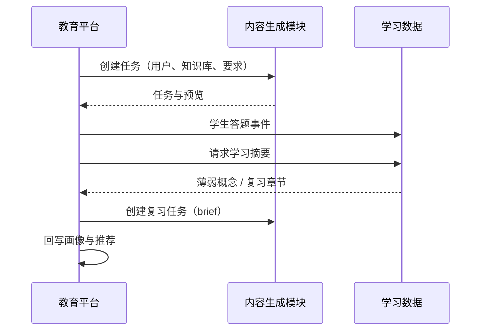

# 对外集成契约

系统预留了一套统一的对外集成契约：生成请求可以携带用户、知识库与平台会话上下文，学习结果可以按同一套字段回传。这样它既能独立运行，也能接入已有的学习平台或业务系统。

## 请求头

创建生成任务时可携带，后端写入任务记录：

| Header | 字段 | 用途 |
|---|---|---|
| `X-Platform-Log-Id` | `platform_log_id` | 跨服务日志追踪 |
| `X-Platform-User-Id` | `platform_user_id` | 学习者/教师标识 |
| `X-Platform-Session-Id` | `platform_session_id` | 平台侧学习会话 |

对应表字段位于 `content_generation_task`。学习会话可据此关联到用户或平台会话。

## 输入：知识库

```json
{
  "content_type": "interactive_html",
  "topic": "提示工程中的少样本示例",
  "user_prompt": "面向零基础学员，用 4 个章节讲解……",
  "knowledge_base_ids": ["kb_123"],
  "generation_options": { "difficulty": "introductory", "max_section_count": 4 }
}
```

- `knowledge_base_ids` 已进入请求契约并持久化。
- 当前本地库由服务配置决定，`knowledge_base_ids` 尚不承担分库授权。通过 `kb_mode` 选择平台库、仅附件或融合检索；通过 `attachments: [{filename, content}]` 传入材料正文。复习请求会保留原材料和检索模式。
- 检索状态通过任务 `progress.knowledge_base` 返回：`used / status / chunk_count / message`。
- 检索未启用时返回 `status="disabled"`、空片段，生成继续；启用后片段以 `RetrievedChunk` 进入状态：

| 字段 | 说明 |
|---|---|
| `id` | 片段 ID |
| `source_id` | 来源文档 ID |
| `source_title` | 来源标题 |
| `content` | 片段正文 |
| `score` | 相关度 |
| `metadata` | 页码、路径等 |

引用通过 `content_generation_reference` 与 `GET /tasks/{id}/references` 对外可见。

## 输出：学习数据

### 学习事件

平台或前端提交：

```json
{
  "section_id": "unit_2_why_it_works",
  "interaction_id": "unit_2_why_it_works_choice",
  "event_type": "single_choice_answered",
  "payload": {
    "selected_option_ids": ["b"],
    "is_correct": false,
    "time_spent_seconds": 40,
    "confidence": "medium",
    "client_timestamp": "2026-11-10T09:00:00Z"
  }
}
```

事件类型见 [learning-loop.md](../design/learning-loop.md)。

### 学习摘要

`GET /api/interactive-lessons/{lesson_id}/sessions/{session_id}/summary`

平台可直接消费的字段：

- `accuracy`、`completion_rate`、`help_requested_count`、`total_time_spent_seconds`；
- `weak_concepts[]`：概念名、薄弱分值、涉及章节；
- `review_sections[]`：建议复习章节；
- `section_progress[]`：逐章作答与正确率。

### adaptive brief

`POST /api/interactive-lessons/{lesson_id}/sessions/{session_id}/adaptive-brief`

平台可用于：

- 直接创建复习任务（`topic_suggestion` + `focus_prompt` + `suggested_difficulty`）；
- 写入学生画像的“最近薄弱点”；
- 触发平台侧推荐或作业布置。

### 离线讲义

`POST /api/content-generation/tasks/{task_id}/export`，`export_type="html"`，`export_options.session_id` 指定会话，导出的 HTML 含答题记录、对错、参考答案与引用。

## 画像数据扩展

如果希望把学习数据继续写入画像服务，建议使用以下字段结构：

```json
{
  "platform_user_id": "u_123",
  "concept_mastery": {
    "少样本示例": { "score": 0.35, "attempts": 4, "last_seen": "2026-11-10T09:00:00Z" }
  },
  "preferred_difficulty": "introductory",
  "common_mistakes": ["把示例数量等同于效果", "忽略示例格式一致性"],
  "recent_sessions": ["session_fff9c77aac06"]
}
```

建议的写入时机：

1. 会话结束后由摘要聚合；
2. brief 生成后更新“最近薄弱点”；
3. 新任务创建时读取画像，作为 `generation_options` 或 brief 的输入。

## 对接顺序


